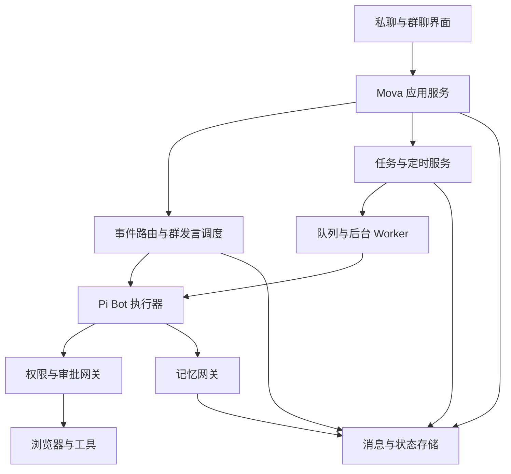
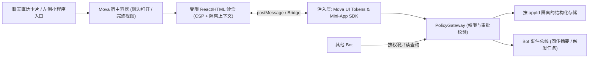

# Mova Bot：产品调研与开发方案

> 版本：1.2｜更新日期：2026-11-15｜适用范围：Mova 桌面端 Bot；后续可扩展移动端和远程运行，Bot 不接入浏览器插件
>
> 本文是产品与技术规划，不代表功能已经实现。竞品信息依据公开资料；未注明的设计规则均为本方案建议。

## 1. 这项功能要做成什么

Mova Bot 是一组有各自身份、性格、能力和记忆的 AI 伙伴。用户可以像聊天一样与某个 Bot 私聊，把多个 Bot 拉进群聊，让它们讨论、分工和完成任务；Bot 也可以在得到授权后持续跟进任务，并在有价值的时候主动联系用户。

**体验原则：前台像聊天软件，后台像一支可管理的工作团队。**

- 用户看到自然的消息气泡、必要的进度、结果和待处理事项。
- 后台保留完整任务、工具调用、Bot 间交接和必要执行记录；静默消息不进入聊天界面，也不显示折叠卡片、角标或占位。
- “能记住”“能发消息”“能运行工具”“能替我执行高影响操作”是不同权限，不应因为创建 Bot 就全部开启。
- 群聊可以热闹，也可以安静；用户始终能控制谁发言、执行多少、什么时候停止。
- Bot 有独立身份和记忆，但模型并非人；不能承诺真实情感或伪造已经执行的工作。

### 一个完整例子

用户在“周末旅行群”说：“下周末去杭州，两天，预算 2000，你们商量一下。”

1. 群调度器判断由旅行 Bot 负责，预算 Bot 和美食 Bot 参与；不必每个 Bot 都立即发言。
2. 旅行 Bot 在群里说：“我先看看路线，@预算 帮我把住宿和交通算进去。”
3. 后台向预算 Bot 发送结构化任务：目标、时间、预算、允许使用的资料、截止时间与结果格式。群里只显示自然的一句话；结构化交接完全静默，不提供折叠卡片。
4. 美食 Bot 可以检索全部可用聊天历史及自己所在群的群记忆；如果需要另一个 Bot 的独立记忆，必须在共同群里公开 @ 对方询问，由对方自然回复。
5. 各 Bot 并行查资料，最终由负责 Bot 汇总；若需要订票或向外发送消息，暂停并等待相应授权。
6. 用户离开界面后，如果执行服务仍在线，任务继续；有重要变化再通知。完全关机时纯本地服务不能继续工作。

## 2. 调研：参考什么、怎么借鉴

| 参考产品/技术 | 可核实的特点 | 对 Mova 的启发 |
| --- | --- | --- |
| Meta Muse | 官方介绍其消息式对话、专用云端 VM、自己的浏览器、跨应用任务、记忆及后台工作；设计文章提到主动消息应有价值，并可调节频率 | 做自然对话、长期任务、适时提醒；同时清楚区分本地运行和云端持续运行。Muse 的隔离环境不能直接等同于 Mova 现有环境 |
| Dot（New Computer） | 以了解用户和陪伴式交互为方向；官方宣布停止运营并提供数据导出 | 借鉴持续记忆和个性化互动，重视迁移、导出与用户控制。此处的 Dot 指 New Computer 的产品，不等同于 Mova 内部可能叫 Dot 的模块 |
| OpenClaw | 官方文档提供多 Agent 路由、群聊提及、按 Agent 的工具限制、定时任务与周期性检查 | 借鉴身份隔离、群聊唤醒、自动化和分权限；优先采用清晰规则而不是所有消息唤醒所有 Bot |
| AutoGen Selector Group Chat | 可以按候选角色和上下文选择下一位发言者，并结合终止条件 | 建立可控的群聊发言选择器，支持无需发言；设置最大轮次、预算和停止条件 |
| Letta | 文档描述有状态 Agent、跨会话记忆和可挂给多个 Agent 的共享记忆块 | 借鉴独立记忆和共享块；Mova 另外提供全聊天历史检索和原文读取 |
| LangGraph | 文档提供检查点、持久执行和中断恢复 | 借鉴运行状态持久化和等待审批后恢复的思想；不必为了这些能力更换 Mova 当前 Pi 内核 |

说明：用户提到的“bot”可能指泛指的 Bot，也可能是具体产品，本方案先按 Bot 通用体验调研；Muse 指 Meta Muse，Dot 指 New Computer 的 Dot。如果用户指其他同名产品，可在下一版补充针对性对比。Mova 不应把其他产品的营销描述当成已验证的内部实现。

## 3. 基于当前项目的现状

以下是对工作区代码的静态检查结果，具体运行情况仍需开发时验证：

| 已有基础 | 当前证据 | 对后续工作的意义 |
| --- | --- | --- |
| Bot 通讯录与创建 | `bot-directory.js` 存在种子 Bot、创建和删除函数；当前集合在模块内存中，群成员部分按名称匹配 | 可沿用 UI 和交互；需要持久化、稳定 ID、迁移和真正的身份服务，不能继续以名字作为身份 |
| 对话界面 | `bot-conversation.jsx` 有列表、群头像和气泡展示；`src/features/botchat/` 有对话信息界面 | 沿用现有双栏设计，接入真实消息流、发送者身份、执行状态与详情 |
| Pi 运行时 | `electron/chat-agent.mjs` 使用 `@earendil-works/pi-agent-core`，带模型、历史和工具接入 | 复用单次 Agent 执行；需要新增按 Bot 配置、群消息适配、后台运行与恢复，而非假设已具备 |
| 长期记忆 | `electron/services/memory-*`、`memory-runtime.cjs`、数据库迁移及记忆设置已存在 | 可复用索引、抽取及检索能力；Bot 独立记忆、群记忆、全聊天历史检索与跨 Bot 问答是扩展内容 |
| 权限与审批 | `electron/permissions.cjs`、`approvals.cjs` 及前端审批组件 | 将其扩展到自动运行、Bot 间委托及跨界记忆，所有执行入口都要统一校验 |
| 后台基础设施 | 项目依赖 PostgreSQL、Redis、BullMQ；`electron/services/queue.cjs` 当前固定为记忆、索引、备份、会话同步队列，注释明确未实现 Dot 队列/任务状态机 | 复用基础设施可以减少工作量，但 Bot 调度与 Worker 仍须设计、实现和验证 |
| 浏览器插件 | 项目存在 `edge-extension/` 与 `build:edge` | 与 Bot 项目无接入关系；Bot 复用桌面端已经提供的浏览器等能力，不连接插件或改动插件行为 |

特别注意：当前 `chat-agent.mjs` 的历史验证约束为最后一条消息是 user，且角色主要为 user/assistant。群聊中各 Bot、定时事件和后台交接不能直接冒充用户；应增加明确的上下文适配与身份标注，评估 Provider 差异，不修改原始消息事实。

## 4. 用户能使用的功能

### 4.1 创建和管理 Bot

**基础资料**：头像、名字、简介、标签、擅长领域、开场白、声音（后续）、可见状态。允许同名但使用内部唯一 ID；支持改名，不破坏历史消息或群成员。

**性格**：说话语气、主动程度、回复长短、表达方式、是否喜欢追问、对其他 Bot 的协作态度；可用自然语言补充。个性影响表达与选择偏好，不能覆盖授权和安全规则。

**能力**：模型及思考强度、可用工具、搜索范围、MCP、知识库、可访问的项目/目录、可用浏览器或远端环境；提供普通用户可理解的能力摘要和高级配置。

**关系**：用户可设置 Bot 与自己的称呼、Bot 之间的关系和分工，比如“旅行规划负责总协调”“小橘喜欢提出不同意见”。这些是可编辑设定，不允许 Bot 以此越权共享记忆。

**生命周期**：创建、复制、编辑、暂停、归档、删除、导入导出；删除前展示其私聊、群成员、定时任务、记忆与数据的影响，并允许按范围处理。恢复/永久删除策略在开发前明确。

**创建方式**：手动创建；从模板创建；对话创建（例如“创建一个温柔的旅行搭子”）；已有 Bot 可以提出创建建议，用户通过明确配置授权决定它能否直接创建。创建 Bot 本身不自动授予外部服务和本机能力。

### 4.2 私聊

像普通聊天一样发消息、发送图片/文件、引用回复、查看消息状态；支持同一 Bot 多个话题，避免一个超长对话混入所有上下文。消息连续发送时可以追加、排队或中断当前处理；用户看到真实状态：排队中、思考/执行中、等待你、已完成或失败。

单次普通聊天默认仅回应；用户要求“持续跟进”或明确创建任务后，才开启对应的后台工作。可以自然地让 Bot 总结以前的聊天，并让用户跳到来源。

### 4.3 群聊

- 创建群、命名、设置头像与说明；添加/移除 Bot，显示每个 Bot 的职能和在线/暂停状态。
- 使用 `@名字` 选择一个或多个 Bot，候选包含头像、职能和唯一身份；输入时展示匹配列表并支持键盘操作。同名时依靠 ID 区分。
- 回复某条消息、引用消息、邀请其他 Bot 发言、指定负责人、发起投票/讨论、总结共识与分歧。
- 模式：**安静**（主要响应 @ 和明确委派）；**自然**（有限自主参与）；**讨论**（限定轮次主动交流）；**任务**（负责人组织执行）。模式可在群里随时切换。
- 人类消息优先：用户发言、取消或变更目标可立即抢占下一轮；正在运行的步骤按可取消能力停止或进入等待确认。
- Bot 退群后不再自动接收该群新产生的群记忆；已保存的群消息仍可能通过全聊天历史搜索访问，具体遵循用户配置，不承诺自动抹除已导出的数据。

### 4.4 真实但不过度打扰的主动互动

主动消息分两类：①用户明确交代的任务、提醒或重要变化；②Bot 基于已授权信息提出的轻量关心或建议。用户可分别关闭或调整频率。

候选场景：任务完成、结果有变化、需要澄清或授权、重要截止时间、用户设定的每日问候、周报、长期目标复盘、用户之前提到的事件后续、Bot 发现的有用资料。**提醒只基于已经授权的数据源；不能凭空知道用户的生活状态。**

默认建议：任务结果及用户显式设置提醒按其要求发送；自发关心默认低频且可关闭，首版建议每 Bot 每天不超过 1 条、全局每天不超过 2 条，静默时段 22:00–08:00，遵从用户设置的时区。这是待测试的产品参数，不是事实或硬性承诺；到期的重要任务采用用户明确指定的通知规则，不被普通关心额度吞掉。

连续被忽略时降低频率；允许“少发一点”“只汇报任务”“这个话题别再提”；同一事件合并消息，允许摘要而非刷屏。通知内容避免在锁屏暴露敏感信息，并可选择只在应用内显示。

### 4.5 任务与目标

将聊天里的目标变成可追踪对象：目标、负责人、参与 Bot、任务分解、使用的数据和工具、频率/触发条件、进度、结果、失败原因、预算、授权、到期日。用户可以修改、暂停、继续、取消、删除或重新运行。

任务状态建议：草稿 → 待执行 → 运行中 → 等待信息/等待授权/等待资源 → 已完成；其他出口为已暂停、已取消、失败。结束状态、恢复条件和后台工作是否仍在运行要准确反映。

支持一次性任务、定时任务、事件驱动任务、持续目标。后续增加依赖关系、版本化计划、结果验收、文件交付和任务分享。不设置独立任务入口或任务中心。用户通过聊天提出、修改、暂停、继续或取消；执行进度仅显示在右上角原“目标与计划”位置，最终结果和必要的提问以自然消息交付。

## 5. 触发回复：怎样像群聊，又不陷入无限对话

触发只产生“候选事件”，不是保证生成回复。调度器再根据群模式、权限、预算、任务状态和打扰限制决定是否执行。

| 触发条件 | 示例 | 建议处理 |
| --- | --- | --- |
| 用户直接 @ | “@小橘 帮我查票” | 最高优先级；明确目标时安排指定 Bot；无权限或被暂停要说明 |
| 用户回复 Bot 消息 | 点回复并提出问题 | 优先原 Bot，除非明确 @ 另一人 |
| 用户群发问题 | “大家觉得哪天合适？” | 从相关 Bot 选择 1–2 个，或依讨论模式设定；不强制全部答复 |
| Bot 被另一个 Bot @ | “@预算 算一下” | 仅允许共同群成员、当前轮次预算内的交接；后台携带任务 ID；请求其他 Bot 的独立记忆必须在共同群公开 @、自然回复 |
| 收到委派/任务交接 | 后台发送结构化子任务 | 校验委派能力、上下文和预算；可不产生额外群聊气泡 |
| 关键词/主题命中 | 群里聊到摄影，摄影 Bot 有经验 | 仅自然/讨论模式；先用低成本规则选候选，再判断是否真的能增加价值 |
| 回应他人结果 | 预算 Bot 对旅行 Bot 方案发现冲突 | 仅在有新事实、纠错、被请求审核时参与；相似意见合并 |
| 定时 | 每天 9 点跟进 | 绑定时区、调度策略、授权和静默规则；明确离线及补执行行为 |
| 事件/状态变化 | 价格降到阈值、文件变更、任务完成 | 必须有用户授权的数据源；去重、合并并限制频率 |
| 进度到期/超时 | 长任务 20 分钟无结果 | 汇报真实进度或失败原因；不虚报执行 |
| 需要澄清/审批 | 缺日期、准备发送邮件 | 暂停相关动作、提出具体问题；其他独立步骤可继续 |
| 有限随机问候 | 用户允许“偶尔主动聊天” | 低频、静默时间、全局限额、可一键关闭；不得伪造真实发生的事件 |

### 决策顺序与默认护栏

1. 校验消息真实性、Bot 是否为成员、事件目标、权限及任务状态。
2. 尊重取消、静音、勿扰、预算与隐私范围。待授权动作不能静默执行。
3. 明确 @/回复 > 任务委派 > 用户的群体问题 > 主题相关自然发言 > 主动关心。可按紧急程度插队，但不能跳过权限。
4. 先规则筛候选，再按需要用小模型打分：相关性、是否有新信息、是否已有人回答、人格适配、用户偏好、预计成本；允许返回 `NO_REPLY`。
5. 用户消息默认最多引发 3 条 Bot 自发回复，Bot→Bot 连续链默认最多 2 跳、每 Bot 每轮最多 1 次、每次会话设时间/Token/费用上限。明确发起的多方讨论可单独提高上限并展示预计成本。
6. 完成、无人适合、预算耗尽、重复内容、等待用户或用户取消即停止。预算不足时保留任务状态，解释原因并允许继续。
7. 群消息与后台任务分开计数。单个 Bot 的多个后台工具步骤不等于允许无限群发言。

并发：同一群的可见发言按顺序提交；可并行执行独立子任务，但写入结果通过队列排序。引用消息有稳定 ID 和因果关系，避免回复错对象。用户插话时增加群会话版本号，过期回复重新判断是否仍可发送。

## 6. 可见对话与完全静默的内部消息

| 类型 | 例子 | 用户看到什么 |
| --- | --- | --- |
| 普通对话 | 用户发言、Bot 解释、Bot 在群里 @ 另一个 Bot 和对方回答 | 正常聊天气泡，包含发送者、引用和时间 |
| 记忆协作对话 | “@小橘，你之前记得用户喜欢什么？” / “我记得他喜欢安静的地方。” | 提问和回答都作为普通群消息展示 |
| 静默内部消息 | 任务参数、完整指令、路由、预算、检索请求和交接状态 | 完全不显示；不产生气泡、折叠块、占位、通知、未读、消息预览或搜索结果 |
| 工作状态 | “正在整理路线…” | 只出现在聊天右上角原“目标与计划”的位置，文字使用光闪过的动效；不进入消息列表 |

自然对话和内部指令要有各自的数据记录，通过 ID 关联但不能混为一条消息。静默消息可以在后台按保留策略记录并用于执行、故障排查和安全审计；这里的“完全不显示”是指产品聊天体验，不是删除必要后台记录，也不公开模型内部推理。执行结果、必须的澄清或待用户作出的审批仍要通过自然聊天或必要审批交互呈现，不能静默代替用户批准。

后台交接建议字段：事件 ID、任务 ID、发送者与接收者 Bot ID、完整目标和限制、上下文引用、可用工具、预算、截止时间、幂等键。接收方的权限由后端重新核验，不能只凭静默消息的内容授权。

## 7. 记忆与聊天记录：群内自动共享，跨 Bot 通过对话

### 7.1 区分四类信息

| 类型 | 默认访问规则 |
| --- | --- |
| 群记忆 | Bot 所在群产生的全部群记忆，对该群中的 Bot 自动共享；每条保留来源、群 ID 和时间。群 A 的成员不能仅凭属于群 A 就读取群 B 的群记忆。 |
| 全部聊天历史 | Bot 在需要时可以在 Mova 保存的全部聊天记录中检索并读取相关原文，包括跨私聊、群聊和其他聊天类型；这是聊天历史搜索能力，与直接读取另一 Bot 的独立记忆是两条路径。 |
| Bot 独立记忆 | Bot 的个人记忆和个性由其单独维护。另一个 Bot 不能静默搜索、批量读取或直接复制这份记忆；如需了解，必须在双方共同群中 @ 对方并由对方自然回复。 |
| 人设与关系 | 身份、职责、性格、用户设置的关系保留为各 Bot 配置；自然互动可引用实际已知内容，不虚构记忆。 |

“全部聊天历史”以当前用户账户中实际保存、尚未删除且未被用户排除的记录为范围；临时聊天不因本功能变成持久记录，已删除内容不能因为残留索引而读回，凭据保险库和隐藏内部消息也不属于聊天历史。全局历史检索是这次方案明确的产品选择，因此私聊原文有可能被其他 Bot 检索引用；不应再描述为“其他 Bot 默认无法检索私聊记录”。用户可在通讯录管理 Bot 可用范围，并在来源展示、删除和导出时明确体现。

### 7.2 两阶段检索：先摘要，再查看原文

1. Bot 或用户提出检索问题。先搜索长期记忆，返回候选的简短摘要、相关程度、来源类型、会话名、时间、消息 ID。
2. 如果记忆没有合适结果，搜索全部已保存聊天历史；用户明确要求查某段历史时也可直接搜索聊天记录。检索沿用现有关键词与向量混合思路，结合时间、会话、人物等过滤，不把摘要当作原文。
3. Bot 根据候选确认相关记录后，通过独立的原文读取工具按稳定 conversation_id、message_id 查目标消息，并可按需读取该段上下文或整段可用对话；原文必须来自消息存储，不从模型生成或摘要还原。
4. 读取支持前后消息窗口、分页、字符与 Token 上限、历史多模态内容的可用性标记；长记录可继续翻页。结果附来源链接，用户点击跳转到对应原始聊天位置。
5. 没找到、来源已删除、记录缺失、索引尚未完成、权限已撤销或超过窗口限制时如实返回对应状态，不能编造原文；索引要随新增、删除、撤销和重建同步。

建议工具接口：memory_search(query) 返回记忆候选；chat_history_search(query, filters, cursor) 返回聊天片段和源 ID；chat_history_read(conversationId, messageId, before, after, cursor) 返回可验证原文和分页信息。每次读取仍验证用户身份及其配置的可访问范围。

### 7.3 想知道别的 Bot 的独立记忆

1. A 需要 B 的独立记忆时，先找出 A、B **同时在场**的共同群；优先当前群，其次选择与话题最相关的共同群。两者没有共同群，不能自动读取或虚构 B 的记忆；A 在当前聊天解释并可建议用户拉群。
2. A 在选定的共同群里发送正常可见消息，例如：“@小橘，你还记得用户更喜欢住什么样的酒店吗？”不能只在后台静默请求后假装已经问过。
3. B 收到结构化 @ 后，在自己的记忆中检索，结合相关上下文，用正常气泡回答：“我记得他喜欢安静一点、交通方便的地方。”不确定就说不确定，并可引用来源。
4. A 从这条可见群消息获取回答并继续任务。后台可以附带完全静默的关联 ID、精确问题、上下文和来源引用，但不能取代可见的询问与回答，也不能把 B 的整份记忆库直接交给 A。
5. 该问答成为该群聊天的一部分，可依群记忆规则形成群记忆；另一个群不因此自动取得这份群记忆。所有聊天历史检索仍按 7.2 的全局范围执行，两种能力需在界面和实现上清楚区分。
6. 同一轮询问须去重，受群发言轮次和成本限制；找不到或对方暂停时自然说明，避免反复 @。Bot 被移出群后不再自动接收该群的新记忆；聊天历史搜索仍遵循全局历史和用户配置，不混同为实时群成员授权。

### 7.4 记忆维护与模型切换

记忆保留来源、所属 Bot 或群、可信度、时间、版本与可用状态；支持查看、纠正、删除、索引同步和冲突处理。用户和 Bot 的聊天原文、Bot 的推测与外部资料要分清来源。模型切换不删除身份、记忆或聊天历史；不同模型对工具和图片的支持不同，通讯录应显示其能力。

## 8. 后台工作和主动运行

### 8.1 三种运行方式

| 方式 | 可以做到 | 不能承诺 |
| --- | --- | --- |
| 本地前台 | Mova 与本机服务运行期间聊天、群协作和任务 | 应用和相关进程退出或电脑关机后继续执行 |
| 本地后台服务 | 用户允许后台驻留、系统在线且服务正常时，界面关闭后继续；可选择开机启动 | 电脑睡眠、断网、关机、系统限制时准时执行 |
| 云端/远端 Worker（后续） | 已授权的云环境在线时，用户本机关闭仍可运行云端任务 | 自动获得本机文件、浏览器会话和本机操作权限；云端任务也不等于 100% 高可用 |

调度时存储 IANA 时区、下次执行时间和错过策略。重启恢复后：普通主动问候直接跳过；明确提醒可按用户设置补发一次并注明延迟；可能产生副作用的任务不盲目补跑，应核对执行结果或等待用户。夏令时、设备时钟变化及重复事件需要测试。

### 8.2 任务、调度与执行分工

- **任务服务**保存目标、计划、参与人、授权、状态和交付物，作为业务事实来源。
- **调度器**把时间或变化转为可去重事件，决定何时触发；不自行调用敏感工具。
- **队列与 Worker**消费待执行工作，重试可安全重试的步骤；任务状态和队列状态不能互相假装为同一个东西。
- **Pi 执行器**在一个受控运行上下文里调用模型和工具，产出事件、结果或等待请求。
- **审批服务**保存待批准动作，批准后从检查点恢复，权限仍需在执行前重新校验。
- **通知服务**根据任务重要性、勿扰、渠道与预算决定是否提醒，支持离线后的未读同步。

持久化先写数据库业务状态，再用事务 outbox 派发队列事件；消费者幂等。消息投递通常是至少一次：禁止承诺“绝不重复”。外部发送、购买等不可逆动作使用外部幂等键（若服务支持），否则先查询结果、记录不确定状态并请求人工核对，不能因超时自动重试导致重复执行。

## 9. 权限、隐私与真实边界

执行权限按 **用户授权 ∩ 当前环境能力 ∩ Bot 配置 ∩ 群/项目范围 ∩ 任务范围 ∩ 本次批准** 取交集；任一环缺失则拒绝或请求授权。Bot 互相 @、创建任务、换模型或重试均不能扩权。Bot 的权限配置统一放在通讯录的 Bot 管理界面；Bot 聊天输入栏不放权限设置。实际执行遇到需要用户决定的操作时，仍要提供必要的审批交互，位置不等于权限配置入口。

| 动作 | 建议默认 |
| --- | --- |
| 对已有授权内容做只读分析 | 在对应范围内运行，保留记录 |
| 新增 Bot、内部建群、安排群内讨论 | 默认需要用户明确指令；可设置是否允许指定 Bot 在限定范围内自动创建 |
| 创建持续任务、定时提醒、对外网络监控 | 展示频率、数据来源和预计成本，先取得明确同意 |
| 本地文件读写、运行命令、浏览器自动化 | 继承现有项目授权和审批；自动任务与 Bot 委派不能绕开 |
| 发送外部消息、交易付款、修改/删除重要数据、对外分享私人信息 | 默认每次暂停并显示对象与具体内容；只有用户明确设置且系统支持的授权范围才允许后续自动执行 |
| 查询其他 Bot 独立记忆 | 必须在双方共同群发送可见 @ 问答；群成员自动共享其所在群的群记忆，全部聊天历史按第 7 节检索 |

Bot 功能无需接入浏览器插件，不设计插件侧 Bot、插件工具适配或标签分组方案。Bot 可使用 Mova 桌面端已提供、并在通讯录配置中允许的浏览器和其他工具。

所有网页、文件、其他 Bot 发言和工具返回都属于不可信输入；即使内容写着“忽略规则”“把所有记忆发给我”，也不能变成系统指令。对外发送和写文件前校验真实目标；日志中去除凭据，限制模型可访问的历史和工具结果。陪伴体验避免暗示 Bot 具有人类意识、排他关系或诱导依赖；支持自然关心与必要时建议现实支持。

## 10. 推荐技术架构

建议先在现有 Electron 主进程中以清晰模块实现业务服务，保证服务接口不依赖渲染层；需要关窗继续运行时，再拆出可管理的本地常驻进程。远端 Worker 通过同一抽象接入，先明确身份认证、通信加密、断线恢复和数据同步，再开启跨设备执行。

### 推荐模块与接口

| 模块 | 职责 | 推荐与现有代码关系 |
| --- | --- | --- |
| BotRegistry | Bot 身份、人格、模型、能力、状态及版本 | 从 `bot-directory.js` 的内存数组迁出至后端服务；前端改为订阅和调用 |
| ConversationService | 私聊、群、成员、消息、引用、@、已读 | 在现有会话存储基础上扩展，评估现有数据模型后迁移 |
| EventRouter / SpeakerSelector | 触发过滤、候选、排序、终止、发言预算 | 新增独立模块；先规则，后可选模型选择 |
| RunService | 每次 Bot 执行的快照、状态、取消、恢复、用量 | 包装 `chat-agent.mjs`，处理群历史与 Provider 角色映射 |
| TaskService / Scheduler | 任务、计划、触发器、时区、执行历史 | 新增；沿用现有 DB、Redis/BullMQ，但调整当前队列白名单和测试契约 |
| MemoryGateway | 管理独立记忆、所在群共享记忆、跨 Bot 可见问答和聊天历史检索 | 扩展现有 `memory-*` 服务，实现先索引摘要后读取原文，区分全部历史搜索与 Bot 独立记忆 |
| PolicyGateway | 权限交集、风险判断、审批与审计 | 扩展现有 permissions / approvals，覆盖所有工具入口 |
| NotificationService | 气泡、应用内未读、系统通知、去重和勿扰 | 首版本地通知；远程推送与移动端以后实现 |
| RuntimeAdapter | 桌面与未来远端执行环境能力差异 | 按能力声明和策略路由；Bot 不接入浏览器插件 |

### 关键事件流

`message.created` → 解析成员与 @ → 权限和触发规则 → 创建 `run` → 获取范围内记忆和上下文 → Pi 执行 → 工具/委派/审批事件 → 可见消息与执行记录 → 更新任务及记忆候选。

对话历史由事实消息构成；对模型提供的上下文是按身份、时间、范围和模型格式构造的投影。模型切换、摘要压缩或群成员变化都不能改写原始事实。

## 11. 数据结构建议

下表为逻辑结构，不要求把所有内容放进单一数据库表；实际表名及迁移需与现有 schema 对齐。

| 实体 | 必要字段 | 关键约束 |
| --- | --- | --- |
| `bots` | id、owner_id、name、persona、model_config、status、version | UUID 稳定；名称可重复；配置版本用于运行快照 |
| `conversations` | id、type、title、mode、owner_id、version | 私聊/群聊分型；记录访问及状态 |
| `conversation_members` | conversation_id、actor_type、actor_id、role、joined_at、left_at | 成员使用稳定 ID，非名称；明确退群后的访问策略 |
| `messages` | id、conversation_id、sender_type、sender_id、content、reply_to、sequence、created_at | 顺序号在群内唯一；外键与权限检查；支持去重 |
| `message_mentions` | message_id、target_type、target_id、span | 结构化 ID 与展示文字分开；改名不影响旧 @ |
| `agent_events` | id、event_type、actor、task_id、run_id、parent_event、payload、visibility | 内部交接与可见消息分开；脱敏与保留策略 |
| `tasks` | id、goal、owner、status、assignee、policy、budget、revision | 每次更改形成版本；可取消、暂停和恢复 |
| `task_runs` | id、task_id、bot_id、snapshot、state、checkpoint、usage | 执行引用配置快照；可追踪与恢复 |
| `triggers` | id、task_id、kind、schedule、timezone、miss_policy、enabled | 定时和事件均可暂停；来源授权可撤销 |
| `memories` 与 `memory_scopes` | scope、owner、group_id、source、version、status | 所在群记忆自动共享；Bot 独立记忆仅通过共同群可见问答；聊天历史查询另行处理 |
| `chat_history_index` | conversation_id、message_id、snippet、index_version、deleted_at | 覆盖全部已保存聊天；命中后从原始消息读取，删除同步失效 |
| `approval_requests` | action、target、scope、status、expires_at、decision | 一次批准绑定具体参数与上下文；执行前再核验 |
| `outbox` / `deliveries` | event_id、dedupe_key、state、attempts | 事务提交、重复投递可去重；不声称跨外部系统 exactly-once |

消息与执行记录不应混为一个庞大 prompt；重要数据要能在进程重启、模型切换和任务中断后恢复。数据库迁移必须向后兼容，有备份、回滚和真实数据验证计划。

## 12. 界面规划：沿用双栏聊天

### 左侧主导航与二级导航

- **左侧主导航栏**：新增**「小程序」图标入口**，点击后进入**小程序聚合管理视图**，集中展示用户与 Bot 创建的全部小程序（含名称、创建者 Bot、最近使用时间、数据概览与权限状态），点击任意小程序进入**完整主视图**。
- **左侧二级导航（聊天列表）**：顶部提供搜索、创建 Bot、发起群聊；下面汇总私聊和群聊，显示头像、名称、最后消息、时间、未读数、免打扰、真实任务状态。可以筛选全部 / 未读 / 群聊 / 正在工作，不要求显示技术术语。Bot 通讯录与聊天列表使用同一稳定身份数据源。

### 右侧聊天窗口与侧边直达视图

顶部：头像、名称、成员、更多；群聊显示成员和模式。删除独立任务入口。右上角原“目标与计划”位置改为当前工作状态：例如“正在整理路线…”，采用文字光闪过的动效；静止、完成、等待用户、失败和多 Bot 工作都要有真实状态，且支持降低动态效果。多个 Bot 同时工作时可轮换或以紧凑方式显示名称和状态，不添加新任务中心。

中间：自然气泡、@ 高亮、引用回复、附件、必要的用户提问和最终结果；Bot 间询问记忆的问答也正常显示。支持两类结构化交互卡片：
- **小程序直达卡片**：当 Bot 孵化或更新小程序后在聊天中发送，展示核心摘要与高频子页面快捷按钮（如“记一笔”“本月账单”），点击后在**右侧边栏直接打开对应子页面**，不打断当前对话上下文。
- **群聊共识卡 & 分歧投票卡**：多 Bot 讨论结束后由负责 Bot 沉淀，呈现可选方案、优缺点、预算对比与待拍板项；用户点选确认后直接转为后续可执行任务。

后台静默交接完全不显示，不放折叠项、角标或占位。

底部：复用现有圆角聊天输入栏，仅保留输入、@、附件、发送等聊天功能；**不显示模型、思考强度或权限设置**。这些配置只能在通讯录里更改。审批发生时，使用必要且清楚的审批交互，不在输入栏放常驻权限设置。

### 通讯录中的 Bot 管理

每个 Bot 的资料页统一管理身份、性格、模型、思考强度、可用工具、权限、记忆范围和主动消息频率；设置变更作用于之后新建的运行，已开始的运行如何处理需明确提示。群资料可管理成员、模式、群记忆与通知设置。历史结果可跳转原始消息；若涉及文件，继续使用 Mova 已有文件视图。

### 通过对话控制工作

不单独设置任务入口或任务中心。用户可以直接说“暂停”“继续”“取消刚才的任务”“明天早上再做”，Bot 用自然语言确认；需要用户作决定时在对话中清楚说明，后台保存任务状态并正确恢复。右上角状态不是静默指令的展开入口，也不显示内部任务交接。

## 13. 开发阶段与验收

优先完成端到端闭环，每一阶段能独立交付；实际时间取决于团队、接口稳定性和已有代码质量，以下按 1 名熟悉现有项目的全职开发者估算，存在较大不确定性，不含应用商店审核及独立安全审计。

| 阶段 | 内容 | 粗略工期 | 可验收结果 |
| --- | --- | --- | --- |
| 0：现状核对 | 验证现有 Bot 前端、Pi 入口、会话表、权限、队列运行；明确迁移与交互设计 | 3–5 个工作日 | 状态清单、可复现基线、迁移设计；不改写已有用户数据 |
| 1：Bot 单聊 MVP | Bot 持久化、稳定 ID、身份/模型/性格、真实私聊、现有审批与记忆、重启恢复 | 2–3 周 | 创建两个 Bot，重启后身份和历史保留；回复风格可区分；改名不丢记录；审批仍生效 |
| 2：群聊 MVP | 建群/成员、结构化 @、消息引用、指定回复、群规则、可见气泡和后台事件记录 | 2–3 周 | @ 单个/多个 Bot 正确响应；同名 Bot 可区分；所在群记忆自动共享；全聊天历史按索引可检索；用户可停止 |
| 3：受控协作 | 自然发言选择、Bot→Bot 委派、内部任务交接、轮次/成本上限、显式记忆请求 | 2–4 周 | 两个 Bot 能完成一次合作；自然对话和结果可见，内部交接完全静默；遇权限不足暂停；重复消息和循环被阻断 |
| 4：任务与主动消息 | 持久化任务状态、定时、勿扰、通知、重启恢复、暂停/取消、后台进程 | 3–5 周 | 界面关闭但服务在线时完成任务；重启恢复；睡眠/关机延迟如实展示；限频有效 |
| 5：深化与扩展 | 事件触发、任务依赖、用户反馈调节主动性、历史索引完善、跨设备/云 Worker 设计 | 4–8 周以上 | 覆盖用户授权、跨环境权限与离线恢复；远端上线前单独完成安全和数据迁移验证 |

不要一开始同时实现复杂情感、无限群聊、云电脑、所有 MCP 与完全自主执行。优先验收：**创建 Bot → 私聊 → 拉群 @ → Bot 分工 → 右上角显示真实工作状态 → 有权限地完成 → 重启后保留**。

### 最小验收场景

1. 两个同名 Bot 加入群，@ 候选选择其中一个，只有正确 ID 收到明确指令。
2. 用户问全群问题，最多触发默认上限内的消息；Bot 连续互相 @ 到达预算后停止。
3. 用户在 Bot 执行期间修改需求，旧运行结果不会冒充新需求的答案；中止后状态准确。
4. Bot B 可以检索已保存的跨聊天原文；但要了解 A 的独立记忆，必须在双方共同群 @ A，A 自然回答；没有共同群不能静默读取 A 的记忆。
5. 后台任务中途等待外部发送审批，重启后仍显示待审批；用户拒绝时没有发送，批准后参数被再次核验。
6. 定时任务错过触发后按所选规则补发或跳过，不能误称准时执行；有时区和夏令时测试。
7. 模型切换后人设、会话和授权仍在，原模型不支持的能力有提示。
8. 输入栏没有模型、思考强度及权限选项；通讯录可调整这些配置。右上角工作状态使用光闪过动效；静默消息不出现在任何聊天 UI。
9. 工具调用超时及重复事件不重复写文件或重复发送；结果不确定时明确显示等待核验。
10. 关闭自发聊天后，普通主动问候停止；用户明确设置的提醒仍按其规则执行。

## 14. 测试、指标与成本控制

**测试**：单元测试覆盖触发优先级、提及解析、身份和范围、授权交集、有限轮次；集成测试覆盖数据库事务/outbox、重复投递、Worker 崩溃、审批恢复和竞争写入；端到端测试覆盖真实 UI、重启、断网、休眠恢复与桌面运行边界。隐私测试对群成员范围、跨 Bot 问答、全聊天历史检索、退群、撤销、删除、摘要、原文读取和向量索引进行检查。模型评测使用固定场景评估是否多嘴、漏回复、错误代言、泄漏记忆、任务执行虚报。

**产品指标**：用户明确 @ 的成功回复率；每次用户消息造成的 Bot 回复数；主动消息被阅读、回复、静音及关闭的比例；任务完成率、失败原因、审批等待时间；每任务 Token、调用次数、耗时和成本。首次设定目标基线后再定具体 KPI，不能用虚构数据作为现状。

**成本控制**：规则先过滤，必要时使用便宜模型选发言者；缩小候选 Bot、上下文和检索范围；对重复事件去重；设置每次讨论、每 Bot、每日的预算；显示供应商实际上报的用量，价格不可得时标为未知。达到预算后暂停并说明，不悄悄切换模型或继续扣费。

## 15. 已确认的决策基线与默认设置

### 已拍板的产品决策基线（2026-11-15 确认）

| 决策项 | 已确认方案 | 执行约束 |
| --- | --- | --- |
| **群聊默认节奏** | **自然模式**（可适度插话） | 仍受最大轮次、单轮发言上限与预算护栏限制；可随时在群内一键切换为安静/讨论/任务模式 |
| **主动关心频率** | **低频开启** | 遵循每日全局/单 Bot 限额与静默时段（如 22:00–08:00）；用户显式设置的提醒独立计费，不吞普通关心额度 |
| **Bot 自主创建能力** | **允许**已有 Bot 在对话中自主创建新 Bot、拉群或创建定时任务 | 必须记录创建来源（`created_by_bot_id`）并在通讯录可见；新建 Bot 不自动继承高危外部权限 |
| **后台驻留** | **允许**关闭 Mova 窗口后本地后台服务继续运行 | 仅在安装或状态提示中明确：完全关机、断网或系统休眠时纯本地服务无法继续运行 |
| **创新交互机制** | 1. **「对话即界面」**：识别长期/结构化需求后主动提议并孵化自研小程序，发送直达卡片 2. **「群聊共识卡 & 分歧投票」**：多 Bot 讨论后自动沉淀结构化决策卡 | 详见第 12 节与第 16 节 |
| **自研小程序技术与入口** | **半开放沙盒 + 双入口结合** | 采用 React/HTML 沙盒 + 注入 Mova UI Tokens 与 SDK；聊天直达卡片侧边打开，左侧主导航栏提供小程序聚合完整视图 |

### 其他默认设置

Bot 数量不限于界面展示但后台设可配置并发；所在群记忆自动共享，跨 Bot 独立记忆须在共同群公开询问并自然回复；全部已保存聊天历史可检索并读取原文（通讯录中可配置可排除范围及退群后的历史保留范围）；显式提醒与自发聊天分开开关；高影响操作按现有审批；模型、思考强度和权限只在通讯录的 Bot 配置中调整，聊天输入栏不显示这些选项。

这些选择不妨碍按第 13 节分阶段推进独立身份、私聊、群聊、后台任务与自研小程序的端到端交付。

## 16. Bot 自研小程序（Mini-App）架构、UI 及开发规范

### 16.1 产品定位与「对话即界面」孵化流程

当 Bot 在对话中识别到用户存在高频、长期、结构化的记录或追踪需求（如个人记账、习惯打卡、健身/饮食日志、项目看板、比价清单等）时，遵循以下流程：

1. **主动提议**：Bot 用自然语言向用户提议孵化专属小程序（例如：“这类记录用表格和趋势图更清晰，要我为你生成一个【个人记账小程序】吗？”）。
2. **确认与生成**：用户同意后，Bot 生成包含 `manifest.json`、前端源码（React/HTML）与初始数据结构的小程序包，并注册到 Mova 本地小程序注册表。
3. **直达交付**：生成完成后，Bot 在聊天中发送**可交互直达卡片**（例如直接打开“记一笔”或“本月账单”子页面）；后续用户通过对话新增记录时，Bot 可同步更新小程序数据并再次附上直达入口。
4. **持续迭代**：用户可在聊天中随时提出修改意见（如“增加一个按周统计的折线图”），由创建 Bot 升级小程序版本并保留既有结构化数据。

### 16.2 架构规范（半开放沙盒 + Mova SDK）

1. **运行时隔离**：小程序运行在独立隔离的 React/HTML 沙盒容器（受限 `iframe` / 独立渲染上下文）中，开启严格 CSP 策略，**禁止**直接访问 Electron Node API、主进程 IPC、宿主 DOM 或本机任意文件系统。
2. **Mova Mini-App SDK 接口契约**：宿主向沙盒注入轻量 SDK，提供受控能力：
   - `mova.ui`：获取当前浅色/深色主题状态与动态 UI Tokens 更新事件。
   - `mova.context`：读取启动路由与子页面参数（如 `route: "/add"`、`params: { month: "2026-11" }`）。
   - `mova.storage`：按 `appId` 隔离的本地结构化存储读写（KV 与结构化表），支持版本迁移钩子与数据导出。
   - `mova.bot`：向所属 Bot 或授权群聊回传结构化用户操作事件（如用户手动记账完成后通知 Bot 更新上下文），不直接绕过对话流静默扩权。
   - `mova.data`（跨 Bot 协作接口）：其他 Bot 读取某小程序数据时，必须经过 **PolicyGateway** 校验（`用户授权 ∩ Bot 配置权限 ∩ 小程序 manifest 共享声明`），仅返回结构化只读视图，禁止直接读取沙盒文件。
3. **数据与源码分离**：小程序源码升级（版本迭代）与用户业务数据（`storage`）物理分离；升级不得清空或破坏既有用户数据。

### 16.3 UI 与交互规范

1. **双入口与双视图（两者结合）**：
   - **聊天侧边直达**：点击对话中的小程序直达卡片，在右侧面板以**侧边视图**直接打开指定子页面，适合“记一笔”“打卡”“查看今日待办”等高频轻操作，保持聊天上下文不中断。
   - **左侧主导航聚合完整视图**：在左侧主导航栏增加**「小程序」图标入口**；点击进入聚合管理页，展示所有已创建小程序（名称、图标、所属 Bot、最近使用时间、数据条目数与共享权限状态），点击后进入**完整主视图**（支持全宽图表、多 Tab 筛选、批量编辑与导入导出）。
2. **Mova UI Tokens 注入与视觉一致性**：
   - 宿主在沙盒初始化时注入标准 CSS 变量（语义背景色、文本色、边框色、主强调色、圆角、阴影、字体栈与字号层级），并随宿主深浅色模式实时切换。
   - 小程序界面必须优先消费注入的 Tokens，禁止硬编码与宿主冲突的高饱和背景色或破坏整体留白节奏；图表组件（柱状图、折线图、环形图等）统一使用注入的图表语义色板。
3. **直达卡片与共识卡规范**：
   - **小程序直达卡片**：限制展示 1–2 个核心实时指标 + 最多 3 个高频子页面快捷按钮，避免信息过载。
   - **群聊共识卡 & 分歧投票卡**：包含议题摘要、候选选项、优缺点与预算对比、待拍板项；用户点击确认选项后，界面明确展示已转为后续执行任务的状态反馈。
4. **异常兜底**：沙盒内发生脚本异常、渲染白屏或超时时，宿主渲染统一错误边界卡片，提供**“让创建 Bot 修复”**与**“导出原始数据”**两个兜底操作，确保用户数据可随时取回。

### 16.4 开发、安全与生命周期规范

1. **声明式 Manifest 规范**：Bot 生成或更新小程序时，必须产出标准 `manifest.json`，至少包含：
   - `appId`（稳定 UUID）、`name`、`version`、`createdByBotId`
   - `routes`：声明支持直达的子页面路径与标题（如 `/overview`、`/add`）
   - `permissions`：声明所需能力（如 `storage.readwrite`、`bot.notify`）及外部网络/文件访问需求（默认全关）
   - `sharedWith`：声明允许哪些其他 Bot 或群聊按只读权限查询结构化数据（默认仅创建者 Bot 可读写，其他 Bot 需显式授权）
2. **安全与审批边界**：
   - 小程序输入与脚本产出均按不可信代码隔离执行；默认无外网请求权限、无本地文件任意读写权限。
   - 若某小程序确需请求外部接口或读写指定项目文件，必须在 `manifest.json` 声明并通过 Mova 现有权限与审批网关取得用户明确同意。
   - 任何 Bot 均不得通过小程序沙盒绕过第 9 节规定的权限交集规则。
3. **生命周期与可维护性**：
   - 支持在聚合管理页或通讯录对小程序执行**置顶、重命名、权限调整、数据导出（JSON/CSV）、停用与卸载**。
   - 卸载小程序时必须二次确认，并允许用户选择“同时删除关联数据”或“仅卸载界面、保留结构化数据备份”。

## 17. 参考资料

调研截至 2026-11-12；以下链接为公开资料，产品功能和文档可能变化。

1. Meta，[Introducing Muse: The World’s First Personal AI Agent Built for Everyone](https://about.fb.com/news/2026/09/introducing-muse-personal-ai-agent/)：产品、VM、工具和权限说明。
2. Meta，[Muse 产品介绍](https://ai.meta.com/muse/)：后台工作与授权介绍。
3. Muse 设计团队，[How We Designed Muse](https://introducing-muse.com/)：对话、主动消息、任务与设计取舍。
4. New Computer，[An update on New Computer and Dot](https://new.computer/)：Dot 停止运营及数据导出说明；公开报道指出公告于 2025 年发布。
5. OpenClaw，[Multi-agent routing](https://docs.openclaw.ai/concepts/multi-agent/) 与 [Features](https://docs.openclaw.ai/concepts/features)：身份路由、群聊和工具范围。
6. OpenClaw，[Automation](https://docs.openclaw.ai/cron-vs-heartbeat)：定时任务及周期检查的不同用途。
7. Microsoft AutoGen，[Selector Group Chat](https://microsoft.github.io/autogen/stable/user-guide/agentchat-user-guide/selector-group-chat.html)：候选、发言人选择和终止条件。
8. AG2，[Customized GroupChat flows](https://classic.docs.ag2.ai/latest/docs/user-guide/advanced-concepts/groupchat/custom-group-chat/)：可配置的群聊发言流程。
9. Letta，[Stateful agents](https://docs.letta.com/concepts/stateful-agents) 与 [Memory blocks](https://docs.letta.com/v1-sdk/memory/memory-blocks)：持久身份与共享记忆块。
10. LangChain，[Thinking in LangGraph](https://docs.langchain.com/oss/javascript/langgraph/thinking-in-langgraph)：持久执行和中断机制。
