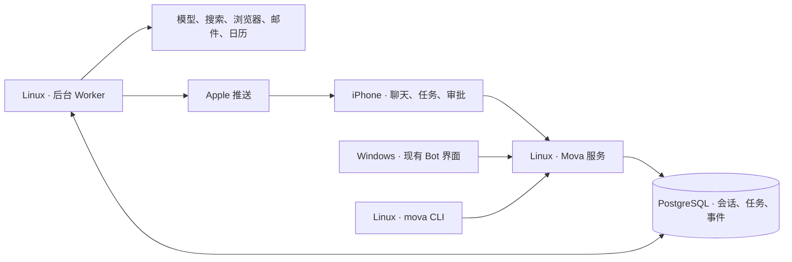

# Mova 云电脑 CLI 与 iPhone 跨端助手方案

2026-11-17 · 首版产品范围与实施计划

**iOS 实施更新**：在用户只有 Windows 与 iPhone 的条件下，客户端已改用独立的 React Native + Expo 工程，并通过 Expo UI 使用原生 SwiftUI 控件。文中纯 SwiftUI 的描述为早期方案；当前开发、真机预览和构建路径以 [iOS 开发环境与框架](Mova-iOS开发环境与框架.md) 为准。服务端与跨端目标保持本文约定。

Linux 实施以 [Mova Linux CLI 详细开发方案](Mova-Linux-CLI详细开发方案.md) 为准。该方案包含本机 Ubuntu 验证、订阅模型、桌面 VPN 同步及浏览器 Skill 移植。

## 结论

首版把 Mova 做成运行在你自己 Linux 云电脑上的个人助手。iPhone 用来交代任务、看进度、审批和收结果。Windows 继续使用现有的 Bot 界面，通过连接云电脑参加同一场对话。Linux CLI 可聊天、查看任务、取消任务和维护服务。iPhone 与 Windows 界面退出后，只要云电脑和服务在线，Bot 就可以继续工作。

首版支持联网搜集资料并给出带来源的计划、登录并操作网站，以及连接邮件和日历管理日程与提醒。优先把第一种做成三端联通的闭环，再接入后两种。跨端仅覆盖云端新建或主动导入的 Bot。导入默认迁移名称、人设与用户明确选中的配置，本地历史和记忆可在后续做独立导入。

首版可用一个场景验收。你在 iPhone 上说「查周六去深圳的三种路线，列出时间、价格和备选方案，帮我准备预约」，然后关闭 App。云端产出带链接的方案。你在 Windows 或手机打开同一条任务，选择其中一个方案并预览网站信息。遇登录时在云浏览器接管，提交前确认内容。随后指定安排，经确认写入日历，并在 iPhone 收到提醒。

## 产品调研

按公开产品文档比较，未进行竞品真机实测。

| 产品 | 已公开的做法 | Mova 借鉴 |
| --- | --- | --- |
| Meta Muse | 每位用户有持久的隔离 Linux 云电脑，手机、桌面和 WhatsApp 可对话，用户可接管浏览器并批准关键操作。 | 浏览器登录状态留在自己的云电脑，手机退出后任务继续。把接管和确认放在任务里。[Muse 产品页](https://muse.ai/) |
| Grok Bot | 手机与桌面可访问同一组 Bot、对话、例行任务和共享云电脑。手机可查看、接管和批准。 | 用同一个 Bot ID、会话 ID 和任务 ID 接续工作，让任务进度、问题和结果可从任一端打开。[Grok Bot 手机文档](https://docs.x.ai/grok-bot/mobile) |
| OpenAI dots | 在 ChatGPT、Slack 和 Teams 接续上下文，能在对话间推进工作并报告进度、问题及待决策事项。 | 给每项委托留一个可回看的任务，只有完成、受阻、待确认等状态变化才主动提醒。[OpenAI dots](https://openai.com/index/introducing-dots/) |
| New Computer Dot | 通过长期互动积累个人上下文，官方已宣布停止运营并给出数据导出安排。 | 让用户能查看、编辑和删除助手记住的偏好，保留自托管数据的导出路径。[New Computer 公告](https://new.computer/) |
| OpenClaw | 将 Gateway 作为主机上的统一入口，连接终端、控制台和 iOS。手机端支持离线缓存及重连补发。 | 将后台进程和 CLI 分开，把多端重连和消息去重视为首版要验收的行为。[Gateway 架构](https://docs.openclaw.ai/concepts/architecture) · [OpenClaw iOS 文档](https://docs.openclaw.ai/platforms/ios) |

首屏采用一个默认助手和任务入口，沿用现有多 Bot 档案。云端群聊、多 Bot 编排、自研小程序及语音排在三端任务体验稳定之后。

## 当前项目的复用与缺口

| 模块 | 源码核对结果 | 首版处理 |
| --- | --- | --- |
| Bot 身份、对话、记忆与审批 | `createBotRuntime` 已装配注册表、对话、记忆、路由和权限服务。Bot 主接线通过 Electron IPC，事件向窗口推送。 | 复用身份、上下文选择、会话抢占及权限规则。抽出无 Electron 的运行器和仓储接口，桌面以客户端接入云服务。[运行时](../../electron/bots/runtime.mjs) · [IPC 接线](../../electron/bots/ipc.mjs) |
| 持久化 | `createBotStore` 从本地 `state.json` 恢复，变更后镜像写入 PostgreSQL 的 `mova_bot_state_kv` 单行。`007` 已定义业务表，但当前 Bot Store 的持久化路径使用整份快照。 | 云端使用 PostgreSQL 业务表作为权威状态。复用现有 schema 定义的资源，增加跨端所需的设备、可重放事件、作业领取及幂等字段。桌面本地 Store 继续承载本地 Bot。[Bot Store](../../electron/bots/store.mjs) · [业务表](../../electron/db/migrations/007_mova_bots.sql) |
| 调度与长任务 | `task-service` 已有任务状态、时区与漏触策略，现有到期触发主要投递会话提醒。运行取消使用进程内 `AbortController`。已有 BullMQ 队列用于记忆、索引、备份和会话同步。 | 抽出任务状态和调度规则，实现进度持久化、Worker 领取、重启恢复及推送。iPhone 和桌面都订阅同一份可重放状态。[任务服务](../../electron/bots/task-service.mjs) · [运行服务](../../electron/bots/run-service.mjs) · [现有队列](../../electron/services/queue.cjs) |
| 搜索与模型 | 通用聊天已有多源检索、正文提取和引用。Bot IPC 里的真实模型调用和工具装配是独立路径，模型不可用时有离线合成回退。 | 单独接入已有 `web-research` skill 和真实模型调用。云端故障公开为限流、配置缺失或执行失败。用真实服务端证据记录区分已搜索、已读和已验证的内容。[搜索实现](../../electron/search/index.cjs) · [研究工具](../../electron/skills/packs/web-research/handlers.mjs) |
| 浏览器与项目文件 | 浏览器 CDP 适配挂在 Electron `webContents.debugger`，桌面控制依赖 Windows 宿主脚本。本地浏览器配置和凭据与宿主绑定。 | Linux 使用独立 Chromium 配置和新的 CDP 传输，复用可移植的快照、观察和动作定义。云端使用云端授权及工作目录，网站会话在云电脑重新登录。[现有 CDP 适配](../../electron/browser/cdp.cjs) · [浏览器控制器](../../electron/browser/controller.cjs) · [桌面宿主](../../electron/desktop/host.cjs) |
| 客户端与部署 | 当前可见入口为 Windows Electron、网页原型和 Edge 扩展，CI 在 Windows。现有 Compose 提供本机数据服务。 | 新增专用 Linux 服务及 CLI、SwiftUI iPhone App、桌面远端 Bot 适配。加入 Linux 测试和 macOS/iPhone 构建验证。[桌面入口](../../electron/main.cjs) · [现有 Compose](../../docker-compose.yml) · [CI](../../.github/workflows/ci.yml) |

专项基线运行了 Bot 和搜索测试，共 182 项，181 通过、1 跳过、0 失败。本次核对范围为 Windows 工作区源码和测试，Linux 云主机、真实模型与外部授权、iPhone 真机连通留给实施阶段验证。

## 三端如何工作

- **Linux 服务**。用现有 Node 24 和 `pg` 依赖，安装为单机服务，配置故障重启、健康检查和备份恢复。首版建议用 PostgreSQL 领取作业、写业务事件和通知待发送记录，便于在同一事务内落库。后续需要独立扩展消费能力时再评估接入现有 Redis/BullMQ。模型和搜索密钥保存在 Linux，使用一个已验证支持工具调用的 API 模型作为首个运行通道。
- **CLI**。作为 Linux 上发消息和运维的入口。拟提供 `mova chat`、`mova task list`、`mova task watch <id>`、`mova task cancel <id>`、`mova doctor`、`mova pair`。聊天与任务命令走三端共用接口。CLI 退出后可重新附着到运行中的任务。已有「CLI 模型」设置继续表示模型供应方式。[现有 CLI 模型开发文档](Mova-CLI模型-开发文档.md)
- **iPhone**。SwiftUI 实现「聊天」「任务」「设置」。任务卡展示计划、进度、来源、执行地点、取消按钮和待确认动作。保存近期记录用于离线查看，发送中的消息可原地重试。用 APNs 通知完成、失败、待确认和已设置的提醒，App 打开后从服务端补齐状态。先确认可用的 Mac 或 macOS 构建环境及 Apple 开发者配置，使用真机和 TestFlight 验收。[Xcode 系统要求](https://developer.apple.com/xcode/system-requirements/) · [TestFlight](https://developer.apple.com/testflight/) · [Apple 后台任务](https://developer.apple.com/documentation/backgroundtasks/) · [APNs](https://developer.apple.com/documentation/usernotifications/registering-your-app-with-apns)
- **Windows**。在 Bot 现有客户端边界增加云端连接，标记 Bot 为「本地」或「云端」。打开云端 Bot 时，读取同一份聊天、任务和确认状态。导入先预览字段、映射模型，保留来源标识以便重复导入时去重，能力按云端环境重新授予。历史、记忆和登录凭据采用各自的权限与迁移流程。

### 桌面设置中的云端入口

已在「设置 → 集成 → 云端与连接」提供 Linux 地址管理、连接检测、AI 部署提示词、本机 WSL 预设和失败诊断。页面使用 Mova 设置规范的 718px 内容列、标准卡片和行。远端地址需要 HTTPS，回环地址可用 HTTP。检测只读取 `GET /v1/health` 并验证兼容协议，成功时显示「服务可访问 · 待配对」。在本机 Ubuntu 运行 `mova serve --port 17642` 即可用桌面检测。设备认证、临时配对码、设备撤销及 Bot、会话、任务同步在后端接入后开放。

### 同步与恢复约定

1. **同步同一份状态。** API 使用 HTTPS，客户端通过 REST 写入、通过 SSE 接收进度。服务端生成稳定的 `botId`、`conversationId`、`taskId` 和消息顺序。客户端凭事件游标补收并去重，游标失效时取快照重建。临时流式文本可以丢失，最终消息、状态、审批与交付物从数据库恢复。
2. **配对与撤销。** 首版为同一用户的 iPhone、Windows 与 CLI 使用短时一次性配对，颁发可单独撤销的设备凭证。iPhone 在 Keychain 保存设备凭证。接入方式首选个人专用网络加 TLS。如采用公网接入，只发布受鉴权的 HTTPS 网关，数据库、浏览器调试连接和运维端口留在内部。
3. **任务保存检查点。** 任务支持排队、运行、等待补充、等待确认、成功、失败和取消。以租约保护执行权并定期记录进度。服务重启后，安全的只读步骤可从检查点继续。对网站提交、发件和日历写入，保存实际动作的回执，超时后先核对外部结果，再决定是否继续。需要人操作时释放执行槽位，等恢复信号再领取任务。
4. **重复请求只创建一次业务记录。** 消息用客户端生成的幂等 ID。确认绑定任务、具体参数和有效期，跨端重复点击返回已有状态。执行前重验当前授权。业务写入与事件在同一事务提交。推送可能重复或延迟，客户端以任务记录为准。

## 首版能力与验收

| 能力 | 最小交付范围 | 验收 |
| --- | --- | --- |
| 联网研究和计划 | 多源搜索、正文阅读、带来源的对比表、取舍、后续步骤，展示更新时间。 | iPhone 发起后关闭 App，CLI 可见运行，Windows 打开原任务即可看结果。断网恢复后无重复消息，每个关键结论可回到对应来源。 |
| 云浏览器代办 | 首版选一个实际网站打通「打开页面 → 提取信息 → 填表预览 → 确认并提交」。登录、验证码或二次认证时切换人工接管，接管期间 Bot 暂停。 | iPhone 能通过受保护的云浏览器入口接管，归还后 Bot 从当前页面继续。重复确认或提交结果不明时，能在界面看到实际状态并核对。第一阶段先验证云电脑现有远控入口能否用手机接管。[Chrome 的远程调试配置](https://developer.chrome.com/blog/remote-debugging-port) |
| 邮件和日历 | 选你日常用的一家服务商。首选实现邮件搜索、摘要与草稿、日历查冲突、拟建日程、确认后创建，以及 Mova 自己的定时提醒。邮件发送留作授权明确后的单独动作。 | 手机用一句话查相关邮件与空闲时间，看到日程预览，在任一端确认一次后，日历只出现一条记录。撤销连接在下一次调用前生效，已设提醒仍可在 Mova 里查看。 |
| 个人偏好 | 首版支持查看、编辑和删除用户主动告诉云端 Bot 的偏好，例如默认出发地点、提醒时段和报告格式。 | 同一个 Bot 在 iPhone 与桌面使用同一份偏好。编辑或删除后，新任务使用最新版本。 |

邮件和日历默认以 Gmail + Google Calendar 估算，实施时以实际主账号为准。若使用 Google，在启动期验证 OAuth 续期，外部应用处于 Testing 状态且请求 Gmail 或 Calendar 相关范围时，刷新令牌通常为七天，影响长期运行。日历按 IANA 时区保存，提醒的漏发补发策略沿用现有任务规则。[Gmail 授权范围](https://developers.google.com/workspace/gmail/api/auth/scopes) · [创建 Calendar 事件](https://developers.google.com/workspace/calendar/api/guides/create-events) · [Google OAuth 令牌有效期](https://developers.google.com/identity/protocols/oauth2#expiration)

云工作区以普通用户运行，浏览器目录独立，网页和邮件内容作为外部数据处理。网站和日历写操作展示具体目标和变更内容，用户确认后由后台执行。模型凭据、网站登录数据和连接器令牌通过服务端的独立凭据存储管理，聊天、客户端同步与推送只传业务状态。通用终端操作、支付、大范围桌面控制和托管多用户留到后续版本。

## 开发顺序

| 阶段 | 预计时间 | 退出条件 |
| --- | --- | --- |
| 0 · Linux 和 iPhone 环境验证 | 2–4 个工作日 | 在目标 Linux 主机确认架构、SSH、持续在线、数据库、模型与搜索出口。在 iPhone 验证私网连接和云浏览器人工接管路径。确认 macOS 构建和 Apple 开发者配置。 |
| 1 · 云服务、CLI、联网计划 | 1–2 周 | Linux 无界面运行时，CLI 可新建云 Bot 并发起真实研究，查看具备可追溯来源的结果。重连、取消、服务重启与消息去重通过。 |
| 2 · iPhone 与 Windows 联通 | 约 2 周 | iPhone 真机完成配对、对话、任务卡、推送和离线恢复。Windows 打开同一会话，支持主动导入一个桌面 Bot 档案。 |
| 3 · 云浏览器代办 | 1–2 周 | 选定网站完成填表、用户接管、参数确认、提交回执和失败恢复，两端均可查看结果。 |
| 4 · 邮件、日历与首版内测 | 1–2 周 | 一个真实账户完成读邮件、出草稿、查日程、建日历和提醒，完成端到端回归、备份和恢复演练。 |

按一人集中开发估算，约第 2–3 周可在 Linux 自用 CLI，约第 4–5 周可试用 iPhone 与 Windows 联动，完整首版约 6–9 周。估算依赖已有云机访问、macOS 构建环境、实际网站及邮件服务授权，Apple 审核耗时和额外站点适配另计。

环境验证需要 Linux 系统和架构、云电脑管理入口以及可用的 Mac 环境。选定常用邮箱日历服务和首个要操作的网站后，可落实后半段的验收场景。先实现「CLI 提交联网研究，断开后重新连接并看到同一份结果」，检验云运行和后续手机同步的共同基础。

## 当前实现

Windows「云端与连接」负责管理员配对、生成 iPhone 配对码、撤销设备和同步订阅线路。现有 iPhone 客户端用 Expo 原生工程实现，在「设置 → 服务连接」输入同一 HTTPS 地址与一次性配对码。设备凭证放入系统钥匙串，打开 App 后自动取回近期 Bot、会话和任务。iPhone 可以发起、取消和重试云任务，Linux 服务持续运行并保存结果。

手机保留最近 30 条云端任务供离线回看。开启「任务状态通知」后，Linux 会将完成、失败和等待处理的状态加入通知队列。通知仅含任务标识和通用状态，内容在打开 App 后从工作区读取。

WSL 已完成服务部署、API 配对和模拟手机到桌面的任务同步。iPhone 网络验收需要系统信任的 HTTPS 服务地址与真机。通知还需要 EAS 项目和 Apple 推送签名，Linux 端设 `MOVA_ENABLE_PUSH=1`，启用 Expo 通知服务的访问令牌保护时另设 `MOVA_EXPO_PUSH_ACCESS_TOKEN`。安装及自托管步骤见 [Mova Linux CLI 详细开发方案](./Mova-Linux-CLI详细开发方案.md#当前版本部署与使用)。[Expo 推送配置](https://docs.expo.dev/push-notifications/push-notifications-setup/)
