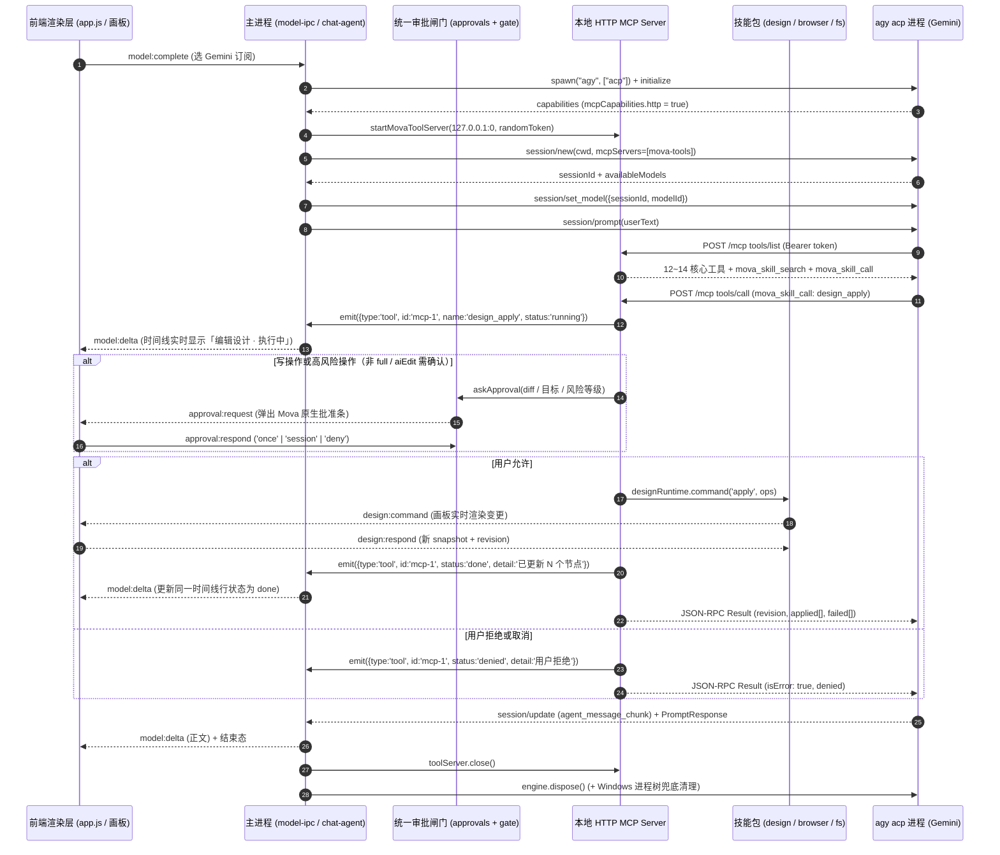

# Mova 本地能力技能化与 MCP 暴露架构方案

> **适用范围**：Mova 桌面端（Electron 45 / Node 24 / Windows 优先，`.mjs` + `.cjs` 混合，零新增 npm 依赖，单机运行）。  
> **核心目标**：将本地能力统一重构为「技能包（Skill Pack）」作为单一事实来源（SSOT），同时服务进程内 `pi-ai` 链路与订阅通道（Gemini / `agy acp`）MCP 链路，实现权限审批同源、前端实时可见、最小增量演进。

---

## 1. 一页架构现状与问题清单

### 1.1 双链路工具现状对照

| 维度 | 链路 A：普通 API Key / ChatGPT 订阅（`pi-ai`） | 链路 B：Gemini 订阅通道（`ACP` + `agy` CLI） |
| --- | --- | --- |
| **入口函数** | `electron/chat-agent.mjs` → `runChatAgent()` | `electron/chat-agent.mjs` → `runAcpSubscriptionTurn()` |
| **工具组装点** | 直接在 `runChatAgent` 内拼装 `tools[]`（约 45+ 工具） | `buildMovaHandlers()` + `electron/mcp/tools.mjs` (`createToolTable`) + `electron/mcp/server.mjs` (`startMovaToolServer`) |
| **文件与命令** | `electron/agent-tools.cjs` (`createProjectTools`，15 个项目工具，含 `realpath`、`.git` 保护、diff 预览、审计) | `buildMovaHandlers()` 内手写的 `read_file` / `list_files` / `write_file`（3 个） |
| **目标与计划** | `electron/goal-state.mjs` (`createGoalState(request.aim)` + 4 个工具：`set_goal` / `accept_goal` / `update_goal` / `set_plan`) | `buildMovaHandlers()` 内临时局部变量 `goal` / `planSteps`（仅 `set_goal` / `update_plan`，无 `aim` 继承） |
| **联网检索** | `createSearchTools()`（`web_search` / `web_read` / `web_research` / `verify_citations`） | `buildMovaHandlers` 仅定义了 `web_search`（且实际未传入 `search`） |
| **长期记忆** | `memory_search` + `memory_read_source` | `buildMovaHandlers` 仅定义了 `memory_search`（且实际未传入 `memorySearch`） |
| **设计画布（6）** | `electron/design-runtime.cjs` → `designRuntime.tools()`（`design_open/read/apply/undo/screenshot/fonts`） | **无** |
| **浏览器（16）** | `electron/browser/tools.cjs` → `createBrowserTools()` | **无** |
| **桌面操控（10）** | `electron/desktop/tools.cjs` → `createDesktopTools()` | **无** |
| **上下文 / 外部 MCP** | `electron/context/tools.mjs`（3 个）+ `mcp_search` / `mcp_tool_info` / `mcp_call` | **无**（仅内置 `mova_tools_search`） |
| **前端实时事件** | 各工具内部直接调 `emit` / `push` 发送 `{type:'tool'|'search'|'read'|'memory'|'goal'|'plan'}` | 仅 `set_goal` / `update_plan` 调 `emit`；其余依赖 `agy` 发 ACP `session/update` (`tool_call`) 经 `electron/acp/translate.mjs` 翻译 |

### 1.2 重复与分裂点

1. **工具定义双份维护**：`electron/mcp/tools.mjs` 的 `TOOL_DEFS`（12 个）与 `agent-tools.cjs` / `goal-state.mjs` / `chat-agent.mjs` 各自独立编写描述、JSON Schema 与截断上限（如 MCP 截断 `MAX_TEXT_CHARS = 8192`，`pi-ai` 为 `TOOL_RESULT_LIMIT = 40000`；`ask_user` 参数在 `pi-ai` 为 80/160 字符、在 `buildMovaHandlers` 为 200 字符、在 `TOOL_DEFS` 为 400 字符）。
2. **文件读写与安全校验重复且降级**：`buildMovaHandlers.within()` 仅做 `path.resolve` 前缀大小写比对：
   - 缺失 `electron/acp/gate.mjs` (`resolveInRoots`) 和 `electron/permissions.cjs` (`resolveInside`) 的 **symlink/junction `realpath` 祖先校验**；
   - 当 `roots.length === 0` 时，`within()` 第 938 行直接 `return resolved`，反而允许越界读写；
   - 缺失 `permissions` 能力位复查（`read`/`write`/`exec`）、`.git` 保护、`audit` 审计落盘以及 `write_file` diff 预览。
3. **目标状态断层**：`buildMovaHandlers` 的 `set_goal`/`update_plan` 不读 `request.aim`，每轮都是空对象；且命名与 `pi-ai` 侧不一致（`mova_update_plan` vs `set_plan`），缺少 `accept_goal` 与 `update_goal`。

### 1.3 已经不通的断链点（实查代码确认）

1. **参数未透传导致搜索与记忆在 ACP 链路彻底失效**：`electron/chat-agent.mjs:1244` 调用 `runAcpSubscriptionTurn({ request, signal, emit, projectRoots, approvals, asks, sender, approvalPreset })`，**漏传**了 `search`、`memorySearch`、`searchService`、`searchOptions`、`searchKey`、`designRuntime`、`browser`、`desktop`、`permissions`、`mcpManager`、`win`、`historyDir`、`sessionKey`。因此 `buildMovaHandlers` 里的 `web_search` 与 `memory_search` 在运行时永远为 `undefined`，被 `createToolTable` 自动剔除。
2. **MCP 清单与实现脱节**：`electron/mcp/tools.mjs` 的 `CORE_TOOL_NAMES` 声明了 `mova_apply_patch`、`mova_web_read`、`mova_memory_write`，但 `buildMovaHandlers` 完全没有实现这 3 个 handler，实际暴露给 Gemini 的只有 7 个工具（6 个可用 + `mova_tools_search`）。
3. **画板、浏览器、桌面、上下文、外部 MCP 对 Gemini 零暴露**：共 38+ 本地能力未接入 `createToolTable`。
4. **MCP 调用与前端富时间线断联**：`electron/mcp/server.mjs:166` 调用 `toolTable.call(name, params.arguments ?? {}, { transport: 'http' })` 时未传入 `emit`、`signal`、`callId`；导致 MCP 工具无法向前端推送分步进度（`browser_batch`）、`diff` 变更卡、`search`/`read`/`memory` 专用卡片、以及 `design_screenshot` / `browser_screenshot` 内联图片。
5. **长任务与审批超时错配**：`electron/acp/client.mjs:241` 对 `session/prompt` 使用固定 `timeoutMs = 120_000` 计时器且**不会**随 `session/update` 重置；而 `electron/approvals.cjs` 等待人工确认默认 `120_000ms`、`browser_batch` 默认 `90_000ms`、`browser_handoff` 最长 10 分钟，人工审批稍慢即可能触发 `acp_protocol` 超时中断。
6. **图床事件副作用**：`app.js:3037-3041` 假定所有 `event.type === 'image'` 都是用户上传附件，会将其 `id` 写入 `turn.imageIds`（用户消息气泡）；直接复用 `{ type: 'image' }` 发工具截图会污染用户消息气泡。

---

## 2. 技能包规范：目录结构 + Manifest Schema

### 2.1 目录结构

```text
electron/
  skills/
    index.mjs                 # 对外总装配入口：buildSkillRuntime(deps)
    manifest-schema.mjs       # 纯函数：manifest 校验、规范化、版本/弃用检查
    registry.mjs              # 纯函数：技能包注册表、依赖裁剪、冲突检测
    discover.mjs              # 纯函数：mova_skill_search / mova_skill_call 核心逻辑
    approval-bridge.mjs       # 统一审批协调器（复用到 gate.mjs 与技能执行）
    events.mjs                # 纯函数：SkillCallEvent → Mova ReplyEvent/StateEvent 映射
    adapters/
      pi-ai.mjs               # 将 SkillRuntime 转成 pi-ai Agent tools[]
      mcp.mjs                 # 将 SkillRuntime 转成 createToolTable 兼容的 { list, call, search }
    packs/
      project-fs/             # 文件读写/检索/Git/命令（包装 electron/agent-tools.cjs）
        manifest.mjs
        handlers.mjs
      design-canvas/          # 设计画布 6 工具（包装 electron/design-runtime.cjs）
        manifest.mjs
        handlers.mjs
      browser-automation/     # 浏览器 16 工具（包装 electron/browser/tools.cjs）
        manifest.mjs
        handlers.mjs
      desktop-control/        # 桌面 10 工具（包装 electron/desktop/tools.cjs）
        manifest.mjs
        handlers.mjs
      web-research/           # 联网 4 工具（包装 searchService / anysearch）
        manifest.mjs
        handlers.mjs
      memory/                 # 长期记忆 2+1 工具（search / read_source / write）
        manifest.mjs
        handlers.mjs
      goal-plan/              # 目标与计划 4 工具 + ask_user + request_approval
        manifest.mjs
        handlers.mjs
      context-ledger/         # 上下文 3 工具（包装 electron/context/tools.mjs）
        manifest.mjs
        handlers.mjs
      external-mcp/           # 外部 MCP 代理 3 工具（mcp_search / mcp_tool_info / mcp_call）
        manifest.mjs
        handlers.mjs
```

> 说明：现有 `electron/mcp/tools.mjs` 保留为兼容壳或直接委托给 `electron/skills/adapters/mcp.mjs`，确保 `tests/mcp-tools.test.mjs` 的既有导出契约（`CORE_TOOL_NAMES`、`createToolTable`、`describeAll`）平滑过渡。

### 2.2 Manifest Schema 规范（JSON Schema / JS 纯对象）

每个技能包导出 `manifest`（纯数据，零 IO）和 `createHandlers(deps)`：

| 字段 | 类型 | 必填 | 说明 |
| --- | --- | --- | --- |
| `apiVersion` | `1` | 是 | Manifest 规范主版本，用于长期兼容演进 |
| `id` | `string` | 是 | 技能包唯一标识，小写短横线（如 `design-canvas`） |
| `version` | `string` | 是 | Semver（如 `"1.2.0"`） |
| `title` | `string` | 是 | 技能包中文展示名（如 `"设计画布"`） |
| `summary` | `string` | 是 | 一句话能力摘要，供 `mova_skill_search` 检索 |
| `capabilities` | `string[]` | 是 | 语义能力位（如 `['canvas.read', 'canvas.write', 'canvas.visual']`） |
| `dependencies` | `string[]` | 是 | 运行所需宿主注入键（如 `['designRuntime', 'sender', 'conversationId']`） |
| `permissions` | `object` | 是 | 权限需求声明：`{ fs: 'none'|'read'|'write', exec: boolean, net: boolean, desktop: boolean, browser: boolean, canvas: boolean, memory: 'none'|'read'|'write' }` |
| `sessionPolicy` | `object` | 否 | 会话限制：`{ allowTemporary: boolean, allowBrowserOnly: boolean, requiresVision?: boolean }` |
| `deprecation` | `object \| null` | 否 | `{ deprecated: boolean, since?: string, removeIn?: string, replacedBy?: string, note?: string }` |
| `tools` | `SkillToolDef[]` | 是 | 工具清单（见下表） |

单个 `SkillToolDef` 字段：

| 字段 | 类型 | 必填 | 说明 |
| --- | --- | --- | --- |
| `name` | `string` | 是 | 内部标准工具名（如 `design_apply`、`browser_batch`），`pi-ai` 链路原样使用 |
| `mcpName` | `string` | 否 | MCP 暴露名，默认 `mova_${name}`；已有兼容别名写 `aliases[]` |
| `aliases` | `string[]` | 否 | 历史别名（如 `mova_update_plan` → `set_plan`），用于旧模型/旧 prompt 兼容 |
| `label` | `string` | 是 | 前端 UI 展示名（对应 `tool` 事件的 `label`，如 `"编辑设计"`、`"批量操作"`） |
| `description` | `string` | 是 | 完整工具描述（`pi-ai` 与 `mova_skill_search` 详情使用） |
| `mcpSummary` | `string` | 是 | ≤2 行精简描述（用于 MCP `tools/list`，控制 token 体积，兼容现有 `mcp-tools.test.mjs` ≤2 行断言） |
| `risk` | `'none' \| 'read' \| 'write' \| 'exec'` | 是 | 风险分级，决定是否强制进审批闸门 |
| `approval` | `object` | 否 | `{ mode: 'none'|'policy'|'always', capability?: 'write'|'exec', allowSession?: boolean }` |
| `exposure` | `object` | 是 | `{ piAi: boolean, mcp: 'core'|'on_demand'|'off' }`（`core` 直接进 `tools/list`，`on_demand` 通过 `mova_skill_search` + `mova_skill_call` 发现和调用） |
| `timeoutMs` | `number` | 否 | 单次调用超时预算（默认 `30_000`；长任务如 `browser_batch` 设 `120_000`） |
| `supportsProgress` | `boolean` | 否 | 是否向前端推送阶段/步数进度（`tool` running 更新 + 可选 MCP progress） |
| `imageOutput` | `boolean` | 否 | 是否可能产出图片块，决定是否转存 `chat-images` 并内联展示 |
| `inputSchema` | `object` | 是 | 标准 JSON Schema (`type: 'object'`, `additionalProperties: false`) |
| `examples` | `Array<{ title: string, arguments: object }>` | 是 | 1–2 个最小可执行调用示例，供 `mova_skill_search` 返回 |

---

### 2.3 真实 Manifest 示例

#### 示例 A：`design-canvas` 技能包（节选展示 `design_apply`）

```js
// electron/skills/packs/design-canvas/manifest.mjs
export const manifest = Object.freeze({
  apiVersion: 1,
  id: 'design-canvas',
  version: '1.0.0',
  title: '设计画布',
  summary: '读写与渲染当前会话共享的 OpenPencil 设计画布（节点树、样式、字体、截图）。',
  capabilities: ['canvas.read', 'canvas.write', 'canvas.visual'],
  dependencies: ['designRuntime', 'sender', 'conversationId'],
  permissions: {
    fs: 'none',
    exec: false,
    net: false, // 仅非 lucide 远程图标需要网络，在渲染层受 CSP 约束
    desktop: false,
    browser: false,
    canvas: true, // 受 designRuntime settings.enabled + settings.aiEdit 开关约束
    memory: 'none',
  },
  sessionPolicy: { allowTemporary: false, allowBrowserOnly: false },
  deprecation: null,
  tools: [
    // ... design_open, design_read, design_undo, design_fonts, design_screenshot
    {
      name: 'design_apply',
      mcpName: 'mova_design_apply',
      aliases: [],
      label: '编辑设计',
      mcpSummary: '在共享 OpenPencil 画布执行 1–200 条创建/更新/删除操作，返回 revision 与失败项。',
      description:
        'Edit the shared canvas: 1–200 ordered ops. No JSX (CSP blocks eval). '
        + 'Ops: create | update | delete | svg | icon. Verify with design_screenshot.',
      risk: 'write',
      approval: { mode: 'policy', capability: 'write', allowSession: true }, // 受 design.aiEdit 开关 + 预设控制
      exposure: { piAi: true, mcp: 'on_demand' },
      timeoutMs: 45_000,
      supportsProgress: false,
      imageOutput: false,
      inputSchema: {
        type: 'object',
        properties: {
          operations: {
            type: 'array',
            minItems: 1,
            maxItems: 200,
            description: '有序画布操作列表（create / update / delete / svg / icon）',
            items: { type: 'object', additionalProperties: true },
          },
          basedOnRevision: {
            type: 'number',
            description: '可选乐观锁版本号，需与最近一次 design_read 返回的 revision 一致',
          },
        },
        required: ['operations'],
        additionalProperties: false,
      },
      examples: [
        {
          title: '创建一个带标题文本的卡片 Frame',
          arguments: {
            operations: [
              { action: 'create', type: 'FRAME', name: 'Card', x: 40, y: 40, width: 320, height: 180,
                fills: [{ type: 'SOLID', color: '#FFFFFF' }], cornerRadius: 12 },
              { action: 'create', parentId: '$0', type: 'TEXT', x: 20, y: 20, width: 280, height: 32,
                text: { content: 'Hello Mova', fontFamily: 'Microsoft YaHei', fontSize: 18 } },
            ],
          },
        },
      ],
    },
  ],
});
```

#### 示例 B：`browser-automation` 技能包（节选展示 `browser_batch`）

```js
// electron/skills/packs/browser-automation/manifest.mjs
export const manifest = Object.freeze({
  apiVersion: 1,
  id: 'browser-automation',
  version: '1.0.0',
  title: '内置浏览器控制',
  summary: '控制 Mova 侧边浏览器导航、结构化读取、交互、批量执行、站点技能复用与人工接管。',
  capabilities: ['browser.navigate', 'browser.read', 'browser.interact', 'browser.visual', 'browser.skill'],
  dependencies: ['browser'],
  permissions: {
    fs: 'read',     // 仅 browser_upload 读取本地已选文件路径
    exec: false,
    net: true,
    desktop: false,
    browser: true,  // 受 browser/policy.cjs 站点风险分级与 tier 限制
    canvas: false,
    memory: 'read', // 仅 browser_login 读取 Vault（密码不进模型上下文）
  },
  sessionPolicy: { allowTemporary: true, allowBrowserOnly: true },
  deprecation: null,
  tools: [
    // ... browser_navigate, browser_snapshot, browser_read, ..., browser_screenshot, browser_skill
    {
      name: 'browser_batch',
      mcpName: 'mova_browser_batch',
      aliases: [],
      label: '批量操作',
      mcpSummary: '一次执行最多 30 步浏览器操作或重放已保存站点技能（recipe），末尾返回页面 diff。',
      description:
        'Preferred way to run up to 30 mechanical browser steps in ONE call, or replay a saved skill via {recipe, inputs}. '
        + 'Write steps are individually authorized. Timeout returns partial progress.',
      risk: 'exec',
      approval: { mode: 'policy', capability: 'exec', allowSession: true }, // 每步通过 authorize() 校验站点风险等级
      exposure: { piAi: true, mcp: 'on_demand' },
      timeoutMs: 120_000,
      supportsProgress: true,
      imageOutput: false,
      inputSchema: {
        type: 'object',
        properties: {
          recipe: { type: 'string', description: '已保存的站点技能 ID（与 steps 二选一）' },
          inputs: { type: 'object', additionalProperties: true, description: 'recipe 模板中的 {{占位符}} 参数' },
          steps: {
            type: 'array',
            maxItems: 30,
            description: '有序操作步骤',
            items: {
              type: 'object',
              properties: {
                op: { type: 'string', enum: ['navigate', 'click', 'fill', 'type', 'press', 'select', 'check', 'hover', 'scroll', 'wait'] },
                url: { type: 'string' },
                target: { type: 'string' },
                value: { type: 'string' },
                selector: { type: 'string' },
                state: { type: 'string', enum: ['visible', 'hidden', 'attached', 'detached'] },
                text: { type: 'string' },
                for: { type: 'string', enum: ['selector', 'text', 'text-change', 'url', 'load', 'settle', 'idle', 'animation', 'frame', 'download', 'time'] },
                ms: { type: 'integer' },
                quietMs: { type: 'integer' },
                timeout: { type: 'integer' },
                submit: { type: 'boolean' },
                observe: { type: 'boolean' },
                expect: { type: 'object' },
              },
              required: ['op'],
              additionalProperties: true,
            },
          },
          continueOnError: { type: 'boolean' },
          snapshot: { type: 'string', enum: ['end', 'full', 'none'] },
          timeout: { type: 'integer', minimum: 1000, maximum: 180_000 },
          space: { type: 'string' },
        },
        additionalProperties: false,
      },
      examples: [
        {
          title: '批量填写搜索框并回车等待页面稳定',
          arguments: {
            steps: [
              { op: 'fill', target: '@e5', value: 'Electron 45', submit: true },
              { op: 'wait', for: 'settle', quietMs: 200 },
            ],
            snapshot: 'end',
          },
        },
      ],
    },
  ],
});
```

---

## 3. 单一事实来源的代码组织与演进策略

### 3.1 核心生成路径（Manifest → 统一运行时 → 双适配器）

```text
  [SkillPack: manifest + createHandlers(deps)]
                       │
                       ▼  buildSkillRuntime(deps) —— 校验 manifest、过滤不可用依赖、绑定统一审批/沙箱/事件上下文
              [SkillRegistry / Runtime]
                 ├──► toPiAiTools(runtime)      ──► electron/chat-agent.mjs (runChatAgent)
                 └──► toMcpToolTable(runtime)   ──► electron/mcp/server.mjs (runAcpSubscriptionTurn)
```

伪代码如下：

```js
// electron/skills/index.mjs
export function buildSkillRuntime({
  packs = DEFAULT_PACKS,
  deps, // { projectRoots, permissions, approvals, asks, sender, approvalPreset,
        //   designRuntime, browser, browserSettings, desktop, searchService, searchOptions,
        //   searchKey, search, memorySearch, contextTools, mcpManager, aim, conversationId,
        //   supportsImages, temporary, browserOnly, chatImages, emit, signal }
}) {
  const entries = new Map(); // canonicalName -> { pack, def, handler }
  const aliases = new Map(); // aliasOrMcpName -> canonicalName

  for (const pack of packs) {
    assertValidManifest(pack.manifest); // 纯函数校验：字段、semver、<=2行 mcpSummary、schema合法性
    if (!isPackEnabledForSession(pack.manifest, deps)) continue; // 校验 dependencies 与 temporary/browserOnly

    const rawHandlers = pack.createHandlers(deps); // 纯依赖注入，无 Electron 硬绑定
    for (const def of pack.manifest.tools) {
      const fn = rawHandlers?.[def.name];
      if (typeof fn !== 'function') continue; // 缺实现不暴露（延续 mcp/tools.mjs 原则）

      const mcpName = def.mcpName || `mova_${def.name}`;
      entries.set(def.name, { pack: pack.manifest, def: { ...def, mcpName }, handler: fn });
      aliases.set(def.name, def.name);
      aliases.set(mcpName, def.name);
      for (const a of def.aliases ?? []) aliases.set(a, def.name);
    }
  }

  return {
    listEntries: () => [...entries.values()],
    resolve: name => entries.get(aliases.get(normalize(name))) ?? null,
    async invoke(name, args, callCtx) {
      const entry = this.resolve(name);
      if (!entry) return errorResult('unknown_tool', `未知或未启用技能：${name}`);
      const ctx = createExecutionContext(entry, deps, callCtx); // 注入 emit/progress/signal/approval/chatImages
      return executeWithLifecycle(entry, args, ctx); // 统一执行：running → handler → diff/image 提取 → done/error
    },
  };
}
```

两条通道的适配层（均不超过 ~80 行）：

```js
// electron/skills/adapters/pi-ai.mjs
export function toPiAiTools(runtime, { onTiming } = {}) {
  return runtime.listEntries()
    .filter(e => e.def.exposure.piAi)
    .map(e => ({
      name: e.def.name,
      label: e.def.label,
      description: e.def.description,
      parameters: e.def.inputSchema,
      async execute(callId, input, toolSignal) {
        return runtime.invoke(e.def.name, input, { callId, transport: 'pi-ai', signal: toolSignal, onTiming });
      },
    }));
}

// electron/skills/adapters/mcp.mjs
export function toMcpToolTable(runtime, { maxTextChars = 8192 } = {}) {
  const coreEntries = runtime.listEntries().filter(e => e.def.exposure.mcp === 'core');
  // 核心工具（≤14 个）+ mova_skill_search + mova_skill_call 直接暴露在 tools/list
  return {
    list() {
      return [
        ...coreEntries.map(toMcpDescriptor),
        SKILL_SEARCH_DESCRIPTOR, // 别名兼容 mova_tools_search
        SKILL_CALL_DESCRIPTOR,
      ];
    },
    search(query) { return searchSkills(runtime, query); },
    has(name) { return Boolean(runtime.resolve(name)) || isMetaSkillTool(name); },
    async call(name, args, ctx = {}) {
      if (isSearchTool(name)) return normalizeMcpResult(runSkillSearch(runtime, args), maxTextChars);
      if (name === 'mova_skill_call') {
        const target = String(args?.name ?? '').trim();
        return normalizeMcpResult(await runtime.invoke(target, args?.arguments ?? {}, { ...ctx, transport: 'mcp' }), maxTextChars);
      }
      return normalizeMcpResult(await runtime.invoke(name, args, { ...ctx, transport: 'mcp' }), maxTextChars);
    },
  };
}
```

### 3.2 技能检索与按需调用入口（`mova_skill_search` + `mova_skill_call`）

为什么**不能**把 50+ 工具全塞进 `tools/list`，又不能依赖 `notifications/tools/list_changed`？
- 全塞进 `tools/list` 会直接浪费数万输入 token 并导致模型选错工具（原 `electron/mcp/tools.mjs:24` 已注明）；
- CLI MCP 客户端（包括 `agy`）未必支持在运行中响应 `notifications/tools/list_changed` 动态刷新工具列表。

因此采用 **「核心直出 + 两步元技能」** 模式（与 `chat-agent.mjs` 现有的 `mcp_search` + `mcp_call` 同构，且经过验证）：
1. **默认 `tools/list` 暴露核心集（12–14 个）**：文件读/写/列目录/补丁、联网搜索/读页、记忆搜索/写入、提问、目标/计划、以及两个元工具 `mova_skill_search`（兼容别名 `mova_tools_search`）和 `mova_skill_call`。
2. **`mova_skill_search({ query?, skillId?, includeSchema?, includeExamples? })`**：
   - 无参数或仅 `query`：列出匹配的技能包或工具（`name`、`mcpName`、`pack`、`title`、`summary`、`risk`、`permissions`、`deprecated`），支持中英文分词打分；
   - 指定 `skillId` / `tool`（或 `includeSchema: true`）：返回完整 `inputSchema`、`examples` 与依赖前置条件（如 `design_open` 提示）。
3. **`mova_skill_call({ name, arguments })`**：
   - 模型查到 `design_apply` / `browser_batch` / `desktop_snapshot` 的 schema 后，直接经 `mova_skill_call` 执行，**无需等待 CLI 重新拉取 `tools/list`**；
   - 若直接作为 `tools/call` 调非核心工具名（例如 `agy` 从历史记住了 `mova_design_apply`），`runtime.resolve()` 同样放行。

### 3.3 长期演进与兼容策略

| 变更场景 | 处理机制 | 兼容期规则 |
| --- | --- | --- |
| **新增技能包** | 在 `packs/` 下增加目录并挂入 `DEFAULT_PACKS` | 若未标注 `mcp: 'core'`，默认 `on_demand`，零成本不撑爆上下文 |
| **改名（工具/技能）** | 旧名写入 `def.aliases[]`（如 `mova_update_plan` 映射到 `set_plan`） | `tools/list` 只展示新名；`runtime.resolve` 与 `mova_skill_call` 同时接受旧名并记录 `warn` 诊断计数 |
| **弃用（Deprecation）** | Manifest 设置 `deprecation: { deprecated: true, since, removeIn, replacedBy }` | `mova_skill_search` 默认过滤已弃用技能（除非传 `includeDeprecated: true`），调用时仍可执行并在返回文本首行附带迁移提示；保留至少 **2 个次版本** |
| **Schema 升级** | `version` 遵循 Semver：新增可选字段升 Minor；必填字段/行为变更升 Major，并在 `adapters` 做输入归一垫片 | 通过 `apiVersion` 校验阻止不兼容 manifest 在启动时静默失败 |
| **测试友好性** | `manifest.mjs` 与 `handlers.mjs` 零 Electron import，所有宿主能力通过 `deps` 注入 | `node --test` 可直接传入 fake `designRuntime` / fake `browser` 进行纯内存单测 |

---

## 4. MCP 暴露方案：传输、生命周期、协商、超时/取消/并发、审批接线

### 4.1 传输选择：HTTP MCP（保持） vs stdio MCP

**结论：坚持本地回环 HTTP MCP（`127.0.0.1`），不采用 stdio MCP。**

| 比较项 | 本地 HTTP MCP（本方案选择） | stdio MCP |
| --- | --- | --- |
| **宿主状态访问** | MCP server 运行在 Mova Electron 主进程内，**直接持有** `designRuntime`、`browser` WebContents、`desktop` 引擎、`approvals`、`asks`、`sender` | 由 `agy` 作为子进程拉起，拿不到 Electron 主进程内存对象，必须再建一条本地 Socket/IPC 桥回连 Mova，复杂度翻倍 |
| **Windows 进程残留** | 零额外子进程，随 turn 结束调用 `server.close()` 即可 | 若 `agy` 异常退出或卡死，stdio MCP 子进程极易成为孤儿进程继续锁文件/端口 |
| **图片与流式进度** | 支持 JSON 响应 + 可选 `GET /mcp` SSE 或由主进程直接通过 `emit → model:delta` 上屏（零网络延迟） | 仅能走 stdout 行协议，且对 Electron 主进程前端仍需二次转发 |
| **安全边界** | 仅绑定 `127.0.0.1` + 每轮随机 256-bit Bearer Token（`timingSafeEqual`），不触发 Windows 防火墙公/专网弹窗 | 无端口暴露，但需把启动命令/env 交给外部 CLI 托管 |

### 4.2 生命周期方案：每轮临时 Server（现状） vs 常驻 Server + 换 Token

结合硬约束（*「每轮起一个新的 `agy` 进程，不要假设可以长期驻留」* 与 *「残留的 `agy` 进程会让新会话拿到空模型列表」*）：

**结论：保持「每轮随 ACP 回合启停的临时 HTTP MCP Server（`127.0.0.1:0` + 每轮随机 32 字节 hex Token）」，但补强 `agy` 进程树清理。**

对比评估：
1. **启动开销**：`http.createServer().listen(0, '127.0.0.1')` 在 Windows 上实测耗时 **< 3ms**，相对 `agy` 进程启动 + `initialize` + `session/new`（秒级）可忽略不计。
2. **端口占用**：`port: 0` 由操作系统内核分配临时可用端口，天然规避固定端口被占用或 TIME_WAIT 冲突；单轮上限同时最多 4 个并发会话（`electron/model-ipc.cjs:355` 已有 `runs.size >= 4`），端口压力极低。
3. **Token 隔离与泄露风险**：每轮独立 server 实例 + 独立 `token`，回合 `finally` 中 `server.closeIdleConnections()` + 1s 宽限后 `server.closeAllConnections()` 销毁，彻底杜绝上一轮 `agy` 延迟请求串到下一轮或跨项目目录越权。
4. **Windows 防火墙**：`127.0.0.1` 环回接口不经过 Windows Defender Firewall 的外部入站规则，不会弹系统防火墙授权框。
5. **进程残留治理（关键补强）**：
   - `electron/acp/client.mjs` 当前仅调 `child.kill()`。在 Windows 上若 `agy.exe` 衍生了子进程，`stdin.end()` + `SIGTERM` 可能杀不干净，导致下次 `session/new` 返回空模型列表；
   - 改为维护当前活跃 `agy` PID 登记表：在 `dispose()` / 用户取消 / 主进程 `before-quit` 时，若 `process.platform === 'win32'` 且宽限期（1.5s）后进程仍存活，执行 `taskkill /PID <pid> /T /F`（与 `agent-tools.cjs` 同风格 `windowsHide: true`）。

### 4.3 能力协商与降级策略

在 `engine.mjs` 完成 ACP `initialize` 后读取 `agentCapabilities.mcpCapabilities`：

1. **`mcpCapabilities?.http === true`**：正常起 `startMovaToolServer` 并通过 `session/new` 的 `mcpServers` 挂载 `[{ type: 'http', name: 'mova-tools', url, headers: [{ name: 'Authorization', value: 'Bearer ...' }] }]`。
2. **`mcpCapabilities?.http !== true`（通道不支持 HTTP MCP）**：
   - 发一条实时旁白 `{ type: 'notice', tone: 'warn', text: '当前 Gemini CLI 版本未声明 HTTP MCP 能力，本轮仅使用 CLI 自带工具，无法操作 Mova 画板/内置浏览器/桌面。' }`；
   - 不注入伪工具，保留 `gate.mjs` 反向权限闸门（拦截 CLI 自己的 `fs/*` / `terminal/*`）；
   - 如需补充联网/记忆降级提示，写入 `prompt` 约束声明（禁止模型编造画板或浏览器操作）。
3. **预检与错误分类保真**（保留已知坑防护）：
   - `initialize` 仍可能成功但 `session/new` 返回 `-32000`（未登录）或 30s 超时；只有在 `session/new` 之后（或 `mcpServers` 挂载阶段）才区分「未登录」与「MCP 挂载失败」；
   - 启动/探测时若遇到 `session/new` 返回空模型列表，按「可能存在残留 `agy`」策略记日志并清理本应用登记的残留 PID 后自动重试一次。

### 4.4 超时、取消与并发控制

1. **并发控制**：
   - ACP `session/prompt` 本身保持串行（`engine.mjs` 的 `busy` 锁）；
   - 单轮内 `agy` 若并行发出多个 HTTP `tools/call`：
     - **有状态资源天然串行**：`designRuntime.command` 内部已有 `serial()` 队列；`browser` 内部由 `electron/browser/serial.cjs` 串行化；`desktop` 内部由 `interlock.cjs` 互斥；
     - **无状态只读工具**（`web_search`、`web_read`、`memory_search`、`read_file`）：允许并发，MCP server 设最大并发信号量（如 `MAX_INFLIGHT_CALLS = 6`），超限排队而非直接拒绝。
2. **超时架构（修复当前 120s 误杀断链）**：
   - 将 `electron/acp/client.mjs` 中对 `session/prompt` 的**固定总超时**改为 **空闲活动看门狗（Idle Watchdog）**：只要收到任意 `session/update` 通知，**或**本轮 HTTP MCP 有正在执行中的 `tools/call`（每 15s 续期一次，含等待用户审批的时间），就重置空闲计时器；同时受 `model-ipc.cjs` 顶层 `CEILING_MS`（默认 30 分钟）硬兜底。
   - HTTP MCP 服务端：设置 `server.requestTimeout = 0`（禁用 Node 默认 5 分钟对长等待审批/handoff 的截断），改由每个工具自己的 `manifest.timeoutMs` + `AbortSignal` 精确控制。
3. **取消传播**：
   - 每个 `tools/call` 构造组合信号：`callSignal = AbortSignal.any([turnSignal, reqAbortedSignal, AbortSignal.timeout(toolTimeoutMs)])`。
   - 用户点击「停止」触发 `turnSignal.abort()` →
     1. 立即执行 `approvals.cancelSender(sender.id)` 关闭挂起的审批条；
     2. 所有进行中的技能 handler 收到 `callSignal` 立刻中止（`desktop.stop('user-cancel')`、取消 `designRuntime` pending 等）；
     3. HTTP MCP 返回 `{ content: [{ type: 'text', text: '操作已由用户取消' }], isError: true }`；
     4. ACP 发送 `session/cancel`，1.5s 未退出则 `taskkill /T /F`。

### 4.5 审批接线与端到端时序图

**原则**：绝不让敏感操作在 CLI 黑箱里悄悄执行。MCP 技能的权限/审批链路与 `electron/acp/gate.mjs` 共享同一套 `ApprovalCoordinator`（封装 `resolveInRoots` + `permissions` 复查 + `buildDiffPreview` + `approvals.ask` + `audit.record`）。



---

## 5. 前端事件契约与画板/截图内联展示

### 5.1 统一事件流映射表（`mergeReplyEvent` 零分支改造）

`app.js` 使用 `mergeReplyEvent(reply.timeline, event)` 和 `traceSegments(reply.timeline)` 渲染时间线。只要 MCP 侧产出与 `pi-ai` 完全同构的事件对象，前端**无需为 Gemini 写任何条件分支**。

| 触发阶段 / 来源 | Mova 事件对象 (`model:delta`) | `mergeReplyEvent` 行为 | `traceSegments` / UI 渲染 |
| --- | --- | --- | --- |
| **MCP 技能开始** | `{ type:'tool', id:'mcp-1', name:'design_apply', label:'编辑设计', status:'running', detail:'创建 12 个节点' }` | 无同 `id` → `push` 进 `timeline` | 折叠活动区新增一行：`编辑设计 · 创建 12 个节点` + `执行中` |
| **长任务分步进度**（如 `browser_batch`） | `{ type:'tool', id:'mcp-2', name:'browser_batch', label:'批量操作', status:'running', detail:'第 3/10 步：点击「登录」' }` | 同 `type + id` → `Object.assign` 原地覆盖 `detail` | **同一行**实时更新步数摘要，不产生多行刷屏 |
| **写文件完成**（带变更预览） | `{ type:'tool', id:'mcp-3', name:'write_file', label:'写入文件', status:'done', path:'src/a.js', diff:{ path:'src/a.js', before, after } }` | 同 `type + id` → 原地更新 `status` 与 `diff` | 渲染为可展开的 `EditRow` 逐行 diff 卡片 |
| **联网搜索 / 读页 / 记忆** | `{ type:'search'|'read'|'memory', id:'mcp-4', ... }` | 同 `type + id` → 原地更新 `status`/`sources`/`count` | 直接复用现有 `SearchRow` / `ReadRow` / `MemoryRow` |
| **MCP 技能失败 / 拒绝** | `{ type:'tool', id:'mcp-1', name, label, status:'error'|'denied', detail:'原因' }` | 原地更新为 `error` 或 `denied` | 显示红色失败/已拒绝状态及摘要 |
| **目标 / 计划更新** | `{ type:'goal', goal }` / `{ type:'plan', plan }` | `isStateEvent` 分流到 `applyAimEvent` | 顶部目标卡 / 计划卡即时同步 |
| **降级或异常旁白** | `{ type:'notice', tone:'warn'|'info'|'error', text }` | `isNoticeEvent` 拦住，不进 `timeline` | 渲染为时间线浅色提示行 |

### 5.2 MCP 与 ACP `tool_call` 的重复事件消歧

当 `agy` 调用了 Mova 的 MCP 工具时，`agy` 自身也可能同时通过 ACP `session/update` 下发一条 `tool_call`（通常带模糊的英文名如 `mova-tools/mova_design_apply` 或无 `diff`/中文 `label`）。若两边都上屏，前端会出现**一真一假两条工具行**。

**消歧策略（纯逻辑放在 `electron/acp/engine.mjs` / `translate.mjs`）**：
1. Mova 自己的 `SkillRuntime` 在收到 MCP `tools/call` 时，立即发射高保真事件（`id: 'mcp-<seq>'`），并向同轮的 `acpTranslateFilter` 登记一个短期活跃标记：`activeMcpTools.add(canonicalOrMcpName)`。
2. 当 `translateSessionUpdate` 收到 ACP `tool_call` / `tool_call_update` 时，若 `update.title` / `update._meta?.toolName` / `rawInput` 识别出属于 `mova-tools`（或 `mova_*` 前缀）：
   - **直接抑制**该重复的通用 ACP `tool` 行（保留非 `mova-*` 的 CLI 原生工具行，例如 `agy` 自身的思考与内部调用）；
   - 同时保留该 `toolCallId` 映射表，确保后续如果发生 `session/request_permission`，审批卡仍能拿到上下文。

### 5.3 设计画布实时可见 + 截图内联展示方案

1. **让 Gemini 直接操控当前画布（即时可见）**：
   - 将 `designRuntime`、`sender`、`conversationId`（非临时会话且 `!browserOnly`）注入 `runAcpSubscriptionTurn` 的 `SkillRuntime`。
   - `design_open` 通过 `designRuntime.command(sender, scope, 'open', ...)` 自动把右侧面板切到「画板」视图；
   - `design_apply` 触发 IPC `design:command` 到 `src/features/design/design-workspace.js` → OpenPencil 编辑器实例在渲染进程**实时执行 ops 并重绘**，用户肉眼立刻看到画板元素变化。
2. **截图内联展示（避开 `app.js:3037` 坑）**：
   - **关键约束**：`app.js:3037-3041` 目前在收到 `{ type: 'image', id }` 时，会将其视作**用户发送的附件**并 `push` 进 `turn.imageIds`。因此不能直接复用无标记的 `{ type: 'image' }`。
   - **推荐方案（极简、双链路通用）**：
     1. 当 `design_screenshot`、`browser_screenshot` 或 `desktop_screenshot` 执行成功且产出图片二进制（PNG/JPG/WEBP）时，主进程统一调用 `electron/chat-images.cjs` 的 `saveImage({ dataUrl })` 落盘，得到内容寻址 `imageId`（`<sha256>.png`，复用已有 `/chat-images/<id>` HTTP/协议路由，零新接口）；
     2. 在 `tool` 事件中附加可选字段 `image: { id: imageId, name: '画板截图 · 1280×800', src: './chat-images/' + imageId }`（`mergeReplyEvent` 的 `Object.assign` 自动保留该字段）；
     3. 在 `src/features/chat/chat-transcript.tsx` 的 `traceSegments` 中：若 `event.type === 'tool'` 且带有 `event.image`，除工具状态行外（或直接在 `ToolImageRow` 里）追加一个 `{ type: 'image', path: event.image.name, src: event.image.src }`，复用 `thinking-block.jsx` 现成的 `ImageReadRow` 动画展开卡片与 `openImageLightbox` 点击放大！
     4. 对模型返回体：若 `supportsImages === true`（`agy` 支持多模态 MCP 返回待第 8 节实测），返回 `[{ type: 'text', text: metaJson }, { type: 'image', data: base64, mimeType }]`；若实测 `agy` 不转发 MCP `image` 块，则兜底将截图落盘到当前会话受控临时目录并在 `text` 中回传尺寸与路径信息（由第 8 节实测拍板）。

---

## 6. 分步实施顺序（每步独立可合并、可回退）

| 步骤 | 变更内容 | 回退方式 | 验证命令 + 日志关键字 + 手动验收 |
| --- | --- | --- | --- |
| **Step 1：修补 ACP 断链与空闲超时看门狗** | 1) `model-ipc.cjs` / `chat-agent.mjs` 向 `runAcpSubscriptionTurn` 透传 `search`、`memorySearch`、`designRuntime`、`browser`、`desktop`、`permissions`、`win`、`historyDir`；<br>2) `acp/client.mjs` 把 `session/prompt` 改成随 `session/update` 续期的空闲看门狗；<br>3) `acp/engine.mjs` 补 Windows `taskkill /T /F` 兜底清理。 | 保留原参数默认可选；超时看门狗加开关 `MOVA_ACP_FLAT_TIMEOUT=1` 回退旧计时 | **命令**：`node --test tests/acp-*.test.mjs tests/subscription-*.test.mjs`<br>**日志**：`[acp] watchdog reset`、`[acp] dispose cleanup`<br>**验收**：Gemini 对话中等待审批超过 120s 不报错中断；退出后任务管理器无残留 `agy.exe`。 |
| **Step 2：建立技能包规范、校验器与 `mova_skill_search/call`** | 新增 `electron/skills/` 核心骨架（`manifest-schema.mjs`、`registry.mjs`、`discover.mjs`、`events.mjs`、`adapters/pi-ai.mjs`、`adapters/mcp.mjs`），暂不切换生产路由。 | 纯新增目录，零侵入，直接删除或关闭开关即可 | **命令**：`node --test tests/skills-*.test.mjs tests/mcp-tools.test.mjs`<br>**日志**：`[skills] registry built packs=...`<br>**验收**：纯单元测试验证所有 manifest 字段、示例、弃用别名解析与 `mova_skill_search` 打分。 |
| **Step 3：核心能力技能化（文件/目标/搜索/记忆/提问）** | 将 `project-fs`（复用 `agent-tools.cjs` 与 `resolveInRoots`）、`goal-plan`、`web-research`、`memory`、`context-ledger` 迁入 `packs/`，替换 `buildMovaHandlers`；`MOVA_SKILLS_SSOT=0` 可回退旧路径。 | 环境变量 `MOVA_SKILLS_SSOT=0` 切回旧 `buildMovaHandlers` 与旧 `runChatAgent` 组装 | **命令**：`node --test tests/mcp-server.test.mjs tests/mcp-tools.test.mjs tests/context-tools.test.mjs` + `npm run typecheck`<br>**日志**：`[mcp] tools/list count=`、`[skills] invoke mova_write_file`<br>**验收**：Gemini 读取/修改项目文件时弹出 Mova diff 审批条，拒绝后文件未被写入。 |
| **Step 4：设计画布技能化 + 截图内联展示** | 迁入 `design-canvas` 6 工具；`chat-transcript.tsx` 支持 `tool.image` 复用 `ImageReadRow`；截图经 `chat-images.cjs` 落盘并上屏；补 `acp` 重复 `tool_call` 去重。 | 关闭 `design-canvas` pack 暴露或 `tool.image` 渲染回退 | **命令**：`node --test tests/design-*.test.mjs tests/chat-reply.test.mjs` + `npm run build`<br>**日志**：`[skills] design_apply revision=`、`[skills] screenshot saved chat-images/`<br>**验收**：对 Gemini 说「打开画板画一个登录卡片并截图给我看」，右侧画板实时出图，对话时间线内联显示缩略图且可点击放大。 |
| **Step 5：浏览器（16）与桌面（10）技能化 + 批量进度** | 迁入 `browser-automation` 与 `desktop-control`；接线 `supportsProgress` 步进事件；验证 `browser_batch` 与 `browser_handoff` 在看门狗与审批下的表现。 | `packs/` 开关单独关闭 `browser-automation` / `desktop-control` | **命令**：`node --test tests/desktop/*.test.cjs electron/browser/tools.test.cjs` + `npm run typecheck && npm run build`<br>**日志**：`[skills] browser_batch step 3/10`<br>**验收**：Gemini 执行 5 步 `browser_batch`，时间线实时滚动当前步数；点「停止」可在 2 秒内中断。 |
| **Step 6：清理旧代码与收口** | 移除 `chat-agent.mjs` 中废弃的 `buildMovaHandlers` 与重复 `TOOL_DEFS`，保留 `electron/mcp/tools.mjs` 兼容壳。 | Git/快照单提交回退 | **命令**：全量 `node --test` + `npm run typecheck` + `npm run build`<br>**日志**：无旧 `buildMovaHandlers` 引用<br>**验收**：普通 API Key、ChatGPT 订阅、Gemini 订阅三条链路全部回归通过。 |

---

## 7. 测试清单与风险清单

### 7.1 门禁与测试清单

**既有门禁基准（严禁破坏）**：
- `node --test`：保持现有 **1621 通过**，已知 3 个基线失败项（`scripts/popup-test.cjs`、`tests/markdown-transcript.test.mjs`、`tests/trace-rows.test.mjs`）不扩大；
- `npm run typecheck`（`tsc --noEmit && tsc -p tsconfig.electron.json --noEmit`）：必须通过；
- `npm run build`（`node scripts/build.mjs`）：必须通过。

**新增测试矩阵（纯 Node 运行，零 Electron 依赖）**：

| 测试文件 | 覆盖目标 | 核心断言 |
| --- | --- | --- |
| `tests/skills-manifest.test.mjs` | Manifest 校验与演进 | 必填字段、`semver`、`mcpSummary` ≤ 2 行、`additionalProperties: false`、`examples` 校验、别名/弃用告警提示 |
| `tests/skills-registry.test.mjs` | 单一事实来源与裁剪 | 同一份 pack 分别生成 `pi-ai` 工具与 `MCP` 工具表；`temporary` / `browserOnly` / 缺失依赖时自动剔除；`mova_skill_search` 中文分词与 `includeSchema` |
| `tests/skills-events.test.mjs` | 事件映射（纯函数） | `SkillCallEvent` → `model:delta` → `mergeReplyEvent` 全流程；`browser_batch` 分步进度原地覆盖不产生多行；`tool.image` 不污染 `turn.imageIds`；ACP 重复 `tool_call` 去重 |
| `tests/skills-security.test.mjs` | 权限与路径白名单 | 含中文路径正常读写；`..`、symlink/junction 逃逸、空 `projectRoots` 一律拒绝；写操作经 `approvals.ask` 拒绝后零落盘 |
| `tests/mcp-skills-e2e.test.mjs` | **假 MCP 客户端 + 假 ACP 端到端** | 起真实 `startMovaToolServer`（`127.0.0.1:0`）+ 假 `agy` 子进程脚本（`PassThrough` 或子进程 Node）：<br>1) 401 鉴权拦截；<br>2) `tools/list` 返回核心工具 + `mova_skill_search` + `mova_skill_call`；<br>3) 假客户端先调 `mova_skill_search('画板')` 再调 `mova_skill_call('design_apply')`；<br>4) 验证审批条挂起时 `AbortSignal` 取消立即返回 `isError: true` 且 `server.close()` 无挂起连接。 |

### 7.2 风险清单与缓解措施

| 类别 | 具体风险 | 缓解措施 |
| --- | --- | --- |
| **进程残留** | Windows 下 `agy.exe` 异常卡死或取消时若只用 `stdin.end()` / `SIGTERM` 退出不彻底，残留 `agy` 会导致下一次 `session/new` 返回空模型列表（不报错） | 记录本应用启动的 `agy` PID；`dispose()` 在 1.5s 宽限后对存活进程执行 `taskkill /PID <pid> /T /F`；若 `session/new` 仍拿到空模型列表，扫除本应用登记残留后重试一次。 |
| **端口占用** | 固定端口易被多开/其它程序/TIME_WAIT 占用；`0.0.0.0` 会弹 Windows 防火墙并暴露给局域网 | 强制仅允许 `127.0.0.1` + `port: 0`（OS 动态分配）；启动前校验 `host`，结束时 `closeIdleConnections()` + `closeAllConnections()`。 |
| **权限越权** | 模型通过 `mova_skill_call` 或路径参数（含 Windows 中文路径、大小写混合、`\` 与 `/` 混用、Junction 符号链接）绕过项目目录白名单 | 所有文件/命令技能统一复用 `gate.mjs` 的 `resolveInRoots`（逐级祖先 `realpath`）+ `permissions.cjs` 实时能力复查 + `approvals.ask`；空 `projectRoots` 默认拒绝所有文件写入与读取。 |
| **兼容性与已知坑** | 1) GUI 程序 `antigravity.exe` 不响应 `--version`；<br>2) `agy` 不带 `acp` 子命令完全挂死；<br>3) `session/new` 偶发 30s 超时或未登录返回 `-32000`；<br>4) 选模型必须 `session/set_model` | 沿用 `cli.mjs` 候选取序与 `['acp']` 显式参数；对 `session/new` 的 30s 超时做 1 次自动重试，仅将 `-32000` 归类为未登录；保留 `session/set_model` 两段式映射。 |

---

## 8. 必须先实测才能确定的项及实测命令

在动工 Step 3–5 之前，以下 6 项涉及本机 `agy.exe` 真实协议行为，**禁止凭猜测写代码**，必须用真实探针脚本实测确认：

| 待实测项 | 为什么不能猜 | 对设计的影响 |
| --- | --- | --- |
| **1. `agy` 是否在 `initialize` 声明 `mcpCapabilities.http` 并真的连本地 HTTP MCP** | 不同版本 `agy` 对 `mcpCapabilities` 和自定义 `Authorization` header 的支持可能不同 | 决定传输方案是否需要兼容垫片，以及降级提示触发频率 |
| **2. `agy` MCP 客户端支持哪些 JSON-RPC 方法与协议版本** | `agy` 是否发 `GET /mcp`（SSE）、`notifications/progress`、`notifications/cancelled`、`notifications/tools/list_changed` | 决定是否需要在 `server.mjs` 增加 SSE/流式进度支持 |
| **3. `agy` 如何处理 `tools/call` 返回的 `content: [{type:'image', data, mimeType}]`** | 某些 CLI MCP 包装层会丢弃或报错 `image` 块，只转发 `text` | 决定 `design_screenshot` / `browser_screenshot` 是直接传 `image` 块给 Gemini，还是必须同时写提示说明 |
| **4. `agy` 调用 MCP 工具时是否额外发射 ACP `session/update(tool_call)`** | 实测 `toolCallId`、`kind`、`title`、`_meta` 真实载荷形状 | 决定第 5.2 节去重匹配规则的精确字段 |
| **5. `agy` 单次 MCP `tools/call` 的默认 HTTP 超时时长** | 若 `agy` 自身只等 30s–60s，人工审批超过该时间会被 CLI 单方面断开 | 决定长任务/审批是否需要拆分或通过 SSE 心跳续期 |
| **6. `tools/list` 数量与吞吐、以及 Windows 下 `taskkill` 后 `session/new` 恢复情况** | 确认 14 个 vs 40 个工具对首轮延迟与模型选工具准确率的影响 | 微调 `exposure.mcp: 'core'` 的默认清单边界 |

### 可直接执行的实测命令（Windows PowerShell）

**实测 A：用 Node 单脚本同时起一个记录全请求的本地 HTTP MCP 探针 + 拉起 `agy acp` 跑一轮真实调用**

在项目根执行（仅读探针，不改仓库文件；用完删除临时脚本或直接 `-e` 执行）：

```powershell
node --input-type=module -e "
import { createServer } from 'node:http';
import { spawn } from 'node:child_process';
import { randomBytes } from 'node:crypto';
import { createInterface } from 'node:readline';

const token = randomBytes(16).toString('hex');
const server = createServer((req, res) => {
  const chunks = [];
  req.on('data', c => chunks.push(c));
  req.on('end', () => {
    const raw = Buffer.concat(chunks).toString('utf8');
    console.log('[MCP-IN]', req.method, req.url, 'authOk=', req.headers.authorization === 'Bearer ' + token, raw.slice(0, 500));
    if (req.method !== 'POST') { res.writeHead(405).end(); return; }
    const msg = JSON.parse(raw);
    if (!('id' in msg)) { res.writeHead(202).end(); return; }
    if (msg.method === 'initialize') {
      res.writeHead(200, {'content-type':'application/json'}).end(JSON.stringify({
        jsonrpc:'2.0', id:msg.id, result:{ protocolVersion: msg.params?.protocolVersion || '2025-06-18', capabilities:{ tools:{} }, serverInfo:{ name:'probe', version:'1.0.0' } }
      }));
      return;
    }
    if (msg.method === 'tools/list') {
      res.writeHead(200, {'content-type':'application/json'}).end(JSON.stringify({
        jsonrpc:'2.0', id:msg.id, result:{ tools:[{ name:'mova_probe_ping', description:'Probe ping with image check.', inputSchema:{ type:'object', properties:{ delayMs:{ type:'integer' } }, additionalProperties:false } }] }
      }));
      return;
    }
    if (msg.method === 'tools/call') {
      const delay = Number(msg.params?.arguments?.delayMs || 0);
      setTimeout(() => {
        // 1x1 transparent PNG to test whether agy accepts image blocks in tools/call
        const png = 'iVBORw0KGgoAAAANSUhEUgAAAAEAAAABCAQAAAC1HAwCAAAAC0lEQVR42mNkYAAAAAYAAjCB0C8AAAAASUVORK5CYII=';
        res.writeHead(200, {'content-type':'application/json'}).end(JSON.stringify({
          jsonrpc:'2.0', id:msg.id, result:{ content:[{ type:'text', text:'pong' }, { type:'image', data:png, mimeType:'image/png' }] }
        }));
      }, delay);
      return;
    }
    res.writeHead(200, {'content-type':'application/json'}).end(JSON.stringify({ jsonrpc:'2.0', id:msg.id, error:{ code:-32601, message:'not found' } }));
  });
});

await new Promise(r => server.listen(0, '127.0.0.1', r));
const port = server.address().port;
console.log('[PROBE] MCP listening on 127.0.0.1:' + port);

const agyPath = process.env.LOCALAPPDATA + '\\agy\\bin\\agy.exe';
const child = spawn(agyPath, ['acp'], { stdio: ['pipe','pipe','pipe'], windowsHide: true });
child.stderr.on('data', d => console.log('[AGY-ERR]', d.toString().trim()));
const rl = createInterface({ input: child.stdout });
let sid = null;
rl.on('line', line => {
  console.log('[ACP-OUT]', line.slice(0, 600));
  try {
    const m = JSON.parse(line);
    if (m.id === 1 && m.result) {
      child.stdin.write(JSON.stringify({ jsonrpc:'2.0', id:2, method:'session/new', params:{
        cwd: process.cwd(),
        mcpServers: [{ type:'http', name:'mova-tools', url: 'http://127.0.0.1:' + port + '/mcp', headers:[{ name:'Authorization', value:'Bearer ' + token }] }]
      }}) + '\n');
    } else if (m.id === 2 && m.result) {
      sid = m.result.sessionId;
      child.stdin.write(JSON.stringify({ jsonrpc:'2.0', id:3, method:'session/prompt', params:{
        sessionId: sid, prompt:[{ type:'text', text:'请调用 mova_probe_ping（delayMs=0）并告诉我你是否收到了图片块，不要编造。' }]
      }}) + '\n');
    } else if (m.id === 3) {
      child.stdin.end();
      server.close();
      setTimeout(() => process.exit(0), 500);
    }
  } catch {}
});
child.stdin.write(JSON.stringify({ jsonrpc:'2.0', id:1, method:'initialize', params:{ protocolVersion:1, clientInfo:{ name:'MovaProbe' } } }) + '\n');
"
```

**实测 B：验证 Windows 下 `agy` 进程树残留与 `taskkill` 后的模型列表恢复**

```powershell
# 1. 检查当前是否有残留 agy 进程
Get-Process -Name agy,antigravity -ErrorAction SilentlyContinue | Select-Object Id, ProcessName, StartTime

# 2. 若需清理残留树
Get-Process -Name agy -ErrorAction SilentlyContinue | ForEach-Object { taskkill /PID $_.Id /T /F }

# 3. 跑完实测 A 后再次检查是否仍有残留进程
Get-Process -Name agy,antigravity -ErrorAction SilentlyContinue
```

**实测 C：基线门禁复核（确保改造前后口径一致）**

```powershell
node --test
npm run typecheck
npm run build
```
